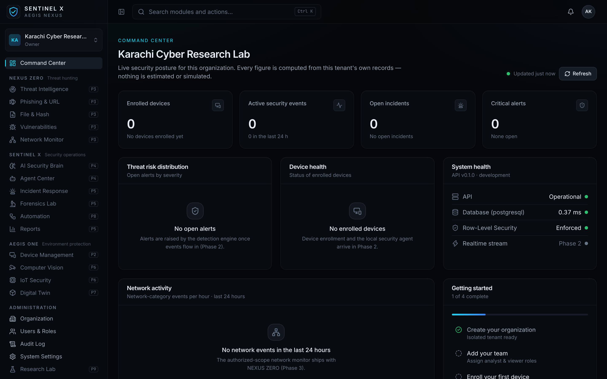
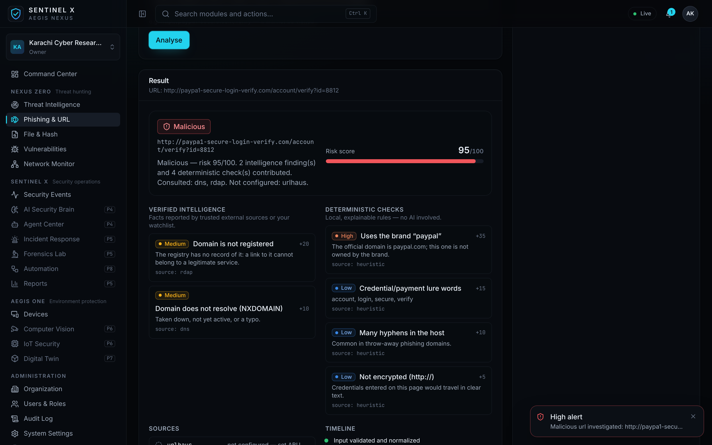
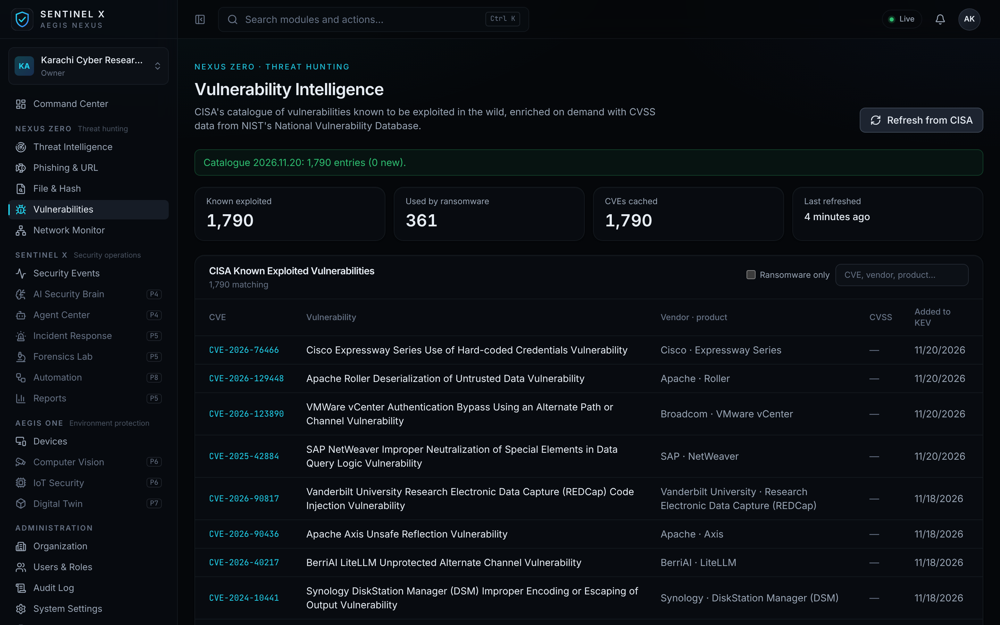
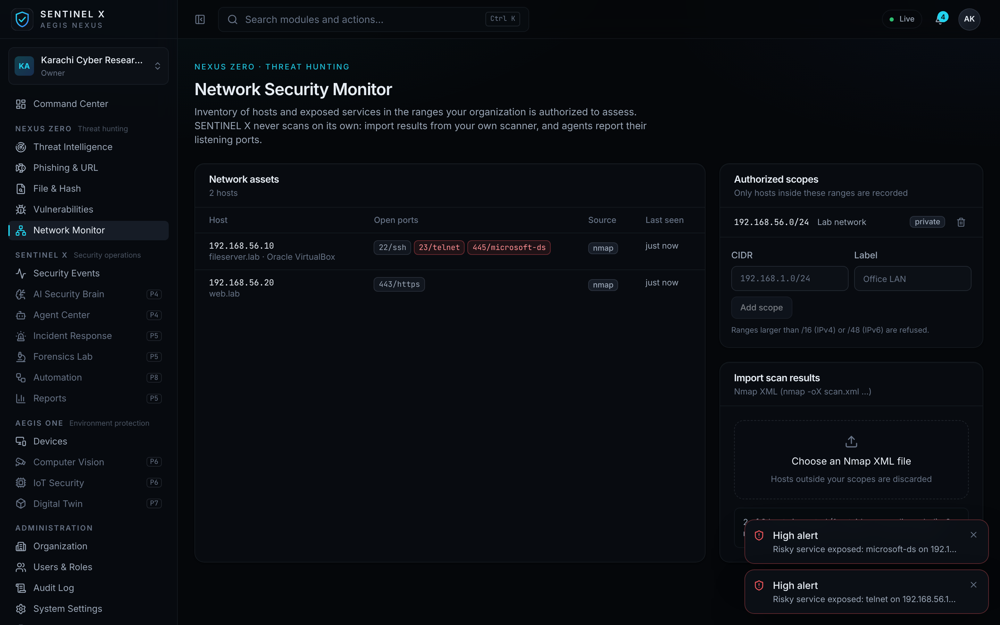
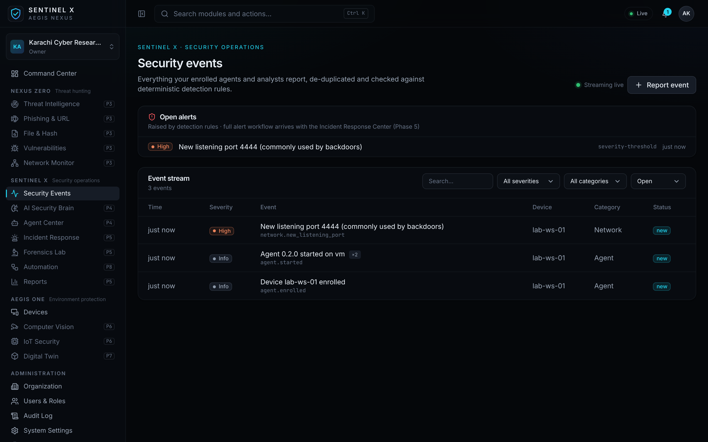
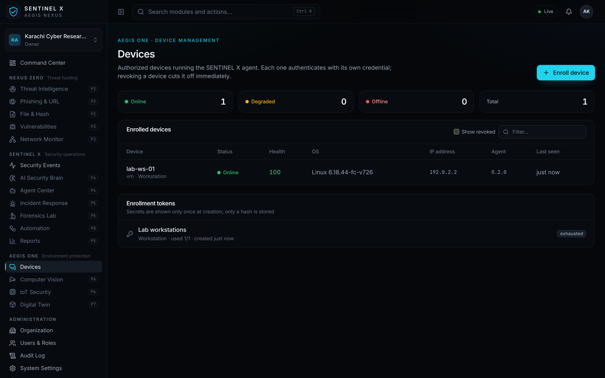
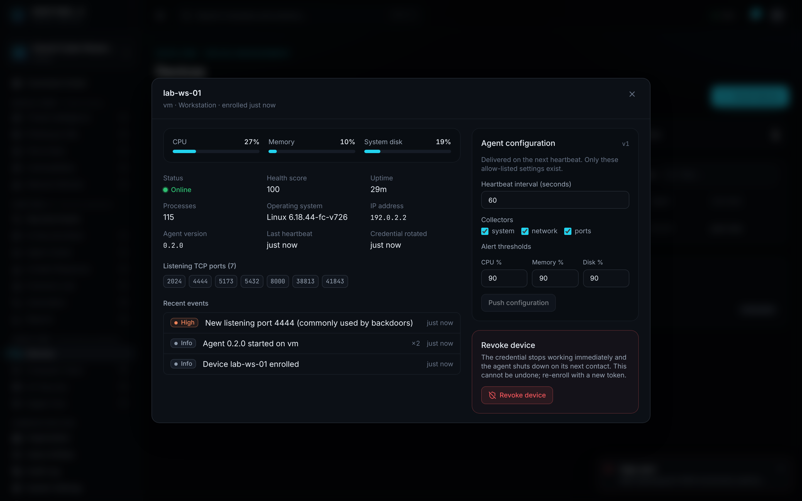

<div align="center">

# SENTINEL X — AEGIS NEXUS

**One Intelligent Platform. Complete Digital Awareness. Autonomous Defense.**

*Detect · Understand · Protect · Automate*

AEGIS ONE (intelligent environment protection) · NEXUS ZERO (AI threat hunting) · SENTINEL X (security operations)

</div>



SENTINEL X is a multi-tenant, AI-assisted security operations platform for cybersecurity
research, authorized enterprise monitoring, intelligent device protection, threat investigation
and **human-approved** automated defense. It is built phase by phase. Every feature marked as done
is implemented end to end and covered by automated tests. Nothing in the UI is a mock or a fake
counter.

> **Status: Phase 9 (Hardening & testing) complete — v0.9.0.** All 20 modules are live.
> Phase 10 (Deployment) is next. Security testing and load-test results:
> [docs/SECURITY.md](docs/SECURITY.md#phase-9-security-testing-results) and
> [docs/PERFORMANCE.md](docs/PERFORMANCE.md). Full list: [docs/ROADMAP.md](docs/ROADMAP.md).

## What works today

| | |
|---|---|
| 🔐 **Authentication** | Registration and login with Argon2id password hashing, a password policy, account lockout and rate limits. Short-lived access tokens are held in memory only. The HttpOnly refresh cookie rotates on every use and has token-reuse (theft) detection. Includes sign-out everywhere. |
| 🏢 **Organizations (tenants)** | Create organizations and switch between them. Every organization's data is isolated at the API layer **and** by PostgreSQL Row-Level Security. |
| 👥 **RBAC** | Four roles: Owner, Admin, Analyst and Viewer. Permissions are stored in the database. Nobody can grant a role above their own, the last owner cannot be removed, and a permission matrix is shown in the UI. |
| 📊 **Command Center** | Shows real tenant metrics: devices, events, incidents, critical alerts, risk distribution, device health, network activity, investigations, agent activity and system health. A new organization shows honest zeros and clear empty states. |
| 🧾 **Audit log** | An append-only trail that also records failed logins and permission denials. Each entry carries the IP and request ID. A database trigger blocks tampering. |
| 🔔 **Notifications** | In-app notifications, for example when you are added to an organization. |
| 🧭 **Console UX** | Dark, responsive design with a collapsible sidebar covering all 20 modules. Includes an org switcher, Ctrl+K global search, a mobile drawer and accessible forms and dialogs. |
| 💻 **Device enrollment** | One-time enrollment tokens are shown once and stored only as a hash, with limited uses and an expiry. Each device gets its own credential, which can be rotated and revoked. Revoking a device disconnects its agent immediately. |
| 🛰️ **Local security agent** | A cross-platform Python agent (`sentinel-agent`). It reports CPU, memory, disk, uptime, network interfaces and listening ports. It detects resource exhaustion and new listening ports, and escalates well-known backdoor ports. It queues events while offline. It **cannot run commands**, and a test enforces that. See [agent/README.md](agent/README.md). |
| 📡 **Event ingestion and detection** | Events are validated, size-limited, normalized and de-duplicated. Deterministic rules (high/critical severity, brute-force logins) raise alerts and notify responders. Events go through a triage workflow, and devices that go silent are marked offline by a background job. |
| ⚡ **Live updates** | A WebSocket stream keeps the dashboard, devices and events current without reloading, and shows live alert toasts. The token travels in the first message, never in the URL. The connection is re-authorized every 5 minutes. |
| 🎣 **Phishing & URL Analyzer** | Analyses links and full email headers without ever opening them. It checks brand impersonation and look-alikes (PayPal, Microsoft, HBL, Meezan, JazzCash, Easypaisa, NADRA, FBR and more), punycode, raw-IP hosts, `@` tricks, risky TLDs, shorteners and disguised executables. For email it checks SPF/DKIM/DMARC, Reply-To and Return-Path mismatches, display-name spoofing and risky attachments. |
| 🌐 **Threat Intelligence** | IP and domain investigations use RDAP (registration age and ownership via the IANA bootstrap), DNS over HTTPS, and optionally URLhaus, AbuseIPDB and VirusTotal. It also keeps an indicator watchlist; automated results never overwrite an analyst's verdict. |
| 🧬 **File & Hash Analyzer** | Hash look-ups in MalwareBazaar and VirusTotal. Files are hashed **in your browser** and never uploaded. |
| 🐞 **Vulnerability Intelligence** | Syncs the CISA Known Exploited Vulnerabilities catalogue (1,790 CVEs) and enriches CVEs on demand from NIST NVD (CVSS, CWE, references). Includes search and a ransomware filter. |
| 🛰️ **Network Security Monitor** | You declare the scopes you are authorized to assess (≤ /16, and public ranges need an attestation), then import Nmap XML; out-of-scope hosts are discarded. Risky or new exposed services raise events, and agents' listening ports feed the inventory. The platform itself never scans. |
| 🧾 **Explainable results** | Every finding shows its source and whether it is verified intelligence or a deterministic check. Each investigation lists the sources consulted, not configured or unavailable, plus a timeline. With no evidence the verdict is "No known threat found", never "safe". Malicious results raise alerts automatically. |
| 🧠 **Security Brain** | An orchestrator runs five specialised agents over an alert, a device or the whole organization and scores risk with a published, weighted model (every model totals 100 points). It shows the factor breakdown, data coverage (missing data lowers coverage instead of being hidden), findings with evidence, playbook recommendations and the full tool trace, and you can download a Markdown report. Every new alert is triaged automatically (P1-P4). The engine is deterministic: no AI model is used. |
| 🤖 **Agent Center** | Lists each agent, the read-only tools it may use and its decision history. Guardrails are enforced in code and by tests: agents cannot write, run commands or reach the network, and recommendations are advice only. |
| 🚨 **Incident Response** | Turn alerts into incidents (`INC-2026-0001`), move them through six statuses, assign and take notes on an append-only timeline. Response actions come from a fixed allow-list: notify responders, heighten monitoring, block an IP/domain/hash, revoke a device, suspend a member. Medium and high impact actions need an approver (high: a second person), can be rolled back where possible, and an **emergency stop** holds everything. |
| 🔬 **Forensics Lab** | Evidence vault: files and notes are hashed (SHA-256) in your browser and on the server, stored immutably, and every download or verification is added to the chain of custody. Large material can be registered by hash. |
| 📑 **Reports** | Incident reports and executive summaries (time to acknowledge, time to resolve, false-positive rate, actions, riskiest devices), built only from your records and downloadable as Markdown. |
| 📟 **IoT Security** | ESP32 / Arduino boards report sensors (directly, or through a local MQTT broker and the agent's bridge). Out-of-range readings raise alerts and can switch the board's LED or buzzer on; you can also switch them for a while by hand. A MicroPython firmware is included, and a clearly labelled **simulator** lets you try everything without hardware. |
| 📷 **Computer Vision** | The agent watches a camera with OpenCV and reports motion, people and people inside the restricted zones you draw — video stays on your computer and nothing identifies anyone. Detection starts off; snapshots are opt-in, blurred and expire. |
| 🧊 **Digital Twin** | A live 3D map of your site (Three.js): devices coloured by status and as tall as their risk, pulsing rings for open alerts, a red beacon for open incidents, sensors and cameras around their board, and network segments. Draw rooms, drag devices into place, or switch to a simple room-by-room list. |
| ⚙️ **Automation** | Workflows from ready recipes: tell the team about serious alerts, send alerts or a daily summary to n8n (Slack, Teams, email), open incidents for critical alerts, let n8n propose blocks. Signed webhooks both ways (HMAC, timestamps, replay protection, SSRF guard, retries). Anything that changes your defences waits for an approver; the emergency stop pauses everything. Guide: [integrations/n8n](integrations/n8n/README.md). |
| 🧪 **Research Lab** | Try a detection rule on a frozen copy of past events before you trust it: precision, recall, F1 and alerts per day next to the built-in rules, labels from what your analysts decided, and a one-click check that every result reproduces. Never touches live alerts. |
| 🛡️ **Hardening** | Every API route checked automatically for authentication and tenant isolation, API fuzzing (Schemathesis), OWASP ZAP scanning, dependency audits, request size limits, Redis-shared rate limits and measured load tests. |
| 🗺️ **Roadmap pages** | Modules that are not built yet show what they will do and which phase delivers them. They contain no fake buttons. |

## Architecture at a glance

```
React + Vite + TS + Tailwind  ──►  FastAPI + Pydantic  ──►  PostgreSQL 16 (RLS)
 (Cloudflare Pages + /api proxy)     (Render, Docker)          (Supabase)
```

* **Backend**: FastAPI, SQLAlchemy 2, Alembic, PyJWT, argon2-cffi. Uses structured JSON logs, request IDs, security headers and a consistent error envelope.
* **Database**: 27 tables covering identity, tenancy, RBAC, audit, devices, cameras, sensors, network assets, events, alerts, incidents, investigations, indicators, CVEs, evidence, agent runs and decisions, response actions, approvals, integrations, workflows, reports and notifications.
* **Frontend**: React 19, TanStack Query, React Router 7, Recharts (lazy-loaded) and lucide icons, with self-hosted fonts so the console makes no third-party requests.

Read more in [docs/ARCHITECTURE.md](docs/ARCHITECTURE.md), [docs/DATABASE.md](docs/DATABASE.md) and
[docs/SECURITY.md](docs/SECURITY.md).

## Quick start (Windows PowerShell)

You need Python 3.11+ (3.12 recommended), Node.js 20+ (22 LTS recommended) and Git.

**Terminal 1: API**

```powershell
git clone https://github.com/adilsultan9878-cell/new-tasks.git sentinel-x-aegis-nexus
cd sentinel-x-aegis-nexus\backend
py -3.12 -m venv .venv
.\.venv\Scripts\Activate.ps1
pip install -r requirements-dev.txt
Copy-Item .env.example .env
alembic upgrade head
uvicorn app.main:app --reload --port 8000
```

**Terminal 2: web console**

```powershell
cd sentinel-x-aegis-nexus\frontend
npm install
npm run dev
```

Open **http://localhost:5173**, create an account and then create your organization.

This quick start uses a local SQLite file, so no database install is needed. For PostgreSQL with
Row-Level Security enforced, run the whole stack with Docker:

```powershell
docker compose up --build      # console on http://localhost:8080
```

macOS/Linux, Docker details and the **cloud deployment (Supabase + Render + Cloudflare Pages)**
are covered in [docs/DEPLOYMENT.md](docs/DEPLOYMENT.md), along with free-tier limitations such as
cold starts and database pausing.

## Monitor a device (agent quick start)

1. In the console go to **Devices → Enroll device** and copy the commands it shows.
2. On the authorized machine, from the repository folder:

```powershell
pip install ./agent
sentinel-agent enroll --server http://localhost:5173 --token sxe.…
sentinel-agent run
```

The device appears within seconds. Try `python -m http.server 4444` on that machine, and the next
heartbeat raises a **High** alert for a new listening port commonly used by backdoors. To remove the
agent, run `sentinel-agent unenroll --purge` and then `pip uninstall sentinel-x-agent`. Background
service setup (Windows Task Scheduler, systemd) is in [agent/README.md](agent/README.md).

## Threat-intelligence API keys (optional, free)

NVD, CISA KEV, RDAP and DNS work without any key. These providers add more coverage when you set
their keys in `backend/.env` (or as Render environment variables):

| Variable | Provider | Sign up |
|---|---|---|
| `ABUSECH_AUTH_KEY` | URLhaus + MalwareBazaar | https://auth.abuse.ch/ |
| `ABUSEIPDB_API_KEY` | AbuseIPDB | https://www.abuseipdb.com/register |
| `VIRUSTOTAL_API_KEY` | VirusTotal | https://www.virustotal.com/gui/join-us |
| `NVD_API_KEY` (optional) | NIST NVD rate limits | https://nvd.nist.gov/developers/request-an-api-key |

The Threat Intelligence page shows which sources are configured.

## Testing

| Suite | Command | Covers |
|---|---|---|
| Backend (SQLite) | `cd backend; pytest` | health, auth, organizations, RBAC, tenant isolation, enrollment, device auth, ingestion, detection rules, sweeper, WebSocket, real agent ↔ live server, investigations (URL/domain/IP/hash/email), SSRF guard, KEV/NVD, scopes, Nmap import, Security Brain agents, scoring and read-only guards, incidents, approvals, emergency stop, evidence and reports, IoT hubs, actuators, vision privacy, simulator, live bridge/camera protocol, digital twin, automation, security sweep over every route, token forgery, body limits, fuzzing regressions, query budgets, Redis rate limits (real Redis), research lab (169 tests) |
| Backend (PostgreSQL + RLS) | `$env:TEST_DATABASE_URL="postgresql://postgres:<pw>@localhost:5432/postgres"; pytest` | everything above, run as the least-privileged DB role, plus RLS proofs for every tenant table evidence and lab immutability triggers, and concurrent-transaction races (179 tests) |
| Agent | `cd agent; python -m pytest` | config allow-list, no-command-execution guard, collectors, detectors, offline spool, revocation, OpenCV camera monitor, MQTT bridge, ESP32 firmware with fake hardware (29 tests; CI runs them on Linux **and Windows**) |
| Frontend unit/component | `cd frontend; npm test` | API client, session refresh, sidebar RBAC, dashboard, devices, events, live WebSocket client, Pages proxy, investigation view, Security Brain, roadmap, SOC, IoT, vision, digital twin, automation and research lab pages (47 tests) |
| End-to-end (Playwright) | `cd frontend; npx playwright install chromium; npx playwright test` | sign-up → org → dashboard → sign-in again; tenant isolation and RBAC; **real agent enrolled from the console, shown live, then revoked**; high-severity report → alert toast; phishing analysis → alert; Nmap import respects scopes; new alert auto-triaged by the Security Brain, organization analysis and report download; alert → incident → approved block → evidence → report, and the emergency stop; simulator → sensors, outputs, camera zone; 3D twin renders, list view, rooms saved; webhook secret shown once, signed test delivery verified by a local receiver, recipe workflows, alert forwarded, incident approved; lab data uploaded, rule backtested and reproduced (15 tests, intel providers offline for determinism) |
| API fuzzing | `cd backend; python scripts/fuzz_api.py` | Schemathesis generates thousands of requests for every operation of the OpenAPI document; fails on any 5xx |
| DAST | `cd backend; python scripts/dast_zap.py` (needs Docker) | OWASP ZAP passive + active scan of every API path, authenticated; fails on Medium/High findings |
| Load test | `pip install -r perf/requirements.txt; locust -f perf/locustfile.py --host http://127.0.0.1:8000` | console users and agents; results and method in [docs/PERFORMANCE.md](docs/PERFORMANCE.md) |
| Lint / types | `ruff check .` · `npm run lint` · `npm run typecheck` | |

CI runs all of the above on every push ([.github/workflows/ci.yml](.github/workflows/ci.yml)).

## Project structure

```
backend/    FastAPI service: app/ (api, core, db, models, rbac, schemas, services), alembic/, tests/
agent/      Python local security agent (sentinel-agent CLI), tests, service files
frontend/   React console: src/ (auth, org, components, pages, config/modules.ts), e2e/, functions/
integrations/n8n/  n8n guide and Node.js signature kit
docker/     Postgres init (creates the RLS-enforcing app role)
docs/       Architecture, database, security/threat model, deployment, roadmap
```

## Credits

Some visual components are adapted from [Magic UI](https://github.com/magicuidesign/magicui) (MIT); see
[THIRD_PARTY_NOTICES.md](THIRD_PARTY_NOTICES.md).

## Responsible use

SENTINEL X is for systems you own or are explicitly authorized to monitor and test. Under the
platform's design rules it never scans the internet, exploits third-party systems, runs
unrestricted remote commands, or takes high-impact actions without human approval. Simulated or
demo data is always labelled. AI output, if a model is ever configured, is marked as AI-generated and kept separate from
verified intelligence; the current Security Brain uses no AI model.

## Screens

| Phishing analysis | Vulnerability intelligence |
|---|---|
|  |  |

| Network monitor | Security events |
|---|---|
|  |  |

| Devices (live) | Device detail |
|---|---|
|  |  |

| Users & Roles | Sign in |
|---|---|
|  |  |
