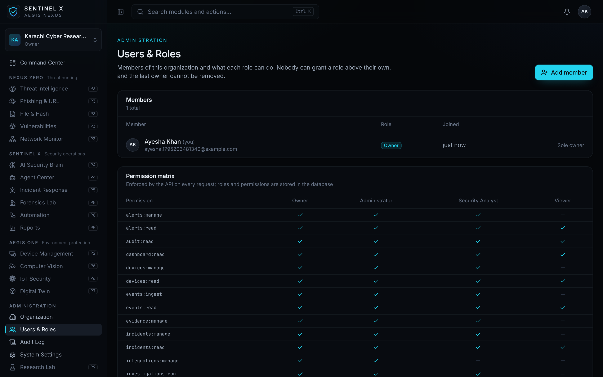
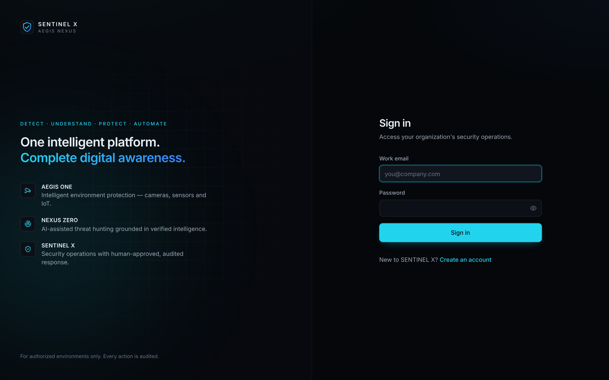

<div align="center">

# SENTINEL X — AEGIS NEXUS

**One Intelligent Platform. Complete Digital Awareness. Autonomous Defense.**

*Detect · Understand · Protect · Automate*

AEGIS ONE (intelligent environment protection) · NEXUS ZERO (AI threat hunting) · SENTINEL X (security operations)

</div>


SENTINEL X is a multi-tenant, AI-assisted security operations platform for cybersecurity
research, authorized enterprise monitoring, intelligent device protection, threat investigation
and **human-approved** automated defense. It is built phase by phase. Every feature marked as done
is implemented end to end and covered by automated tests. Nothing in the UI is a mock or a fake
counter.

> **Status: Phase 2 (Security Event Engine) complete — v0.2.0.** Phase 1 (Foundation) shipped in
> v0.1.0; Phase 3 (NEXUS ZERO threat intelligence) is next. See [docs/ROADMAP.md](docs/ROADMAP.md)
> for the full list of completed and pending features.

## What works today

| | |
|---|---|
| 🔐 **Authentication** | Registration and login with Argon2id password hashing, a password policy, account lockout and rate limits. Short-lived access tokens are held in memory only. The HttpOnly refresh cookie rotates on every use and has token-reuse (theft) detection. Includes sign-out everywhere. |
| 🏢 **Organizations (tenants)** | Create organizations and switch between them. Every organization's data is isolated at the API layer **and** by PostgreSQL Row-Level Security. |
| 👥 **RBAC** | Four roles: Owner, Admin, Analyst and Viewer. Permissions are stored in the database. Nobody can grant a role above their own, the last owner cannot be removed, and a permission matrix is shown in the UI. |
| 📊 **Command Center** | Shows real tenant metrics: devices, events, incidents, critical alerts, risk distribution, device health, network activity, investigations, agent activity and system health. A new organization shows honest zeros and clear empty states. |
| 🧾 **Audit log** | An append-only trail that also records failed logins and permission denials. Each entry carries the IP and request ID. A database trigger blocks tampering. |
| 🔔 **Notifications** | In-app notifications, for example when you are added to an organization. |
| 🧭 **Console UX** | Dark, responsive design with a collapsible sidebar covering all 20 modules. Includes an org switcher, Ctrl+K global search, a mobile drawer and accessible forms and dialogs. |
| 💻 **Device enrollment** | One-time enrollment tokens are shown once and stored only as a hash, with limited uses and an expiry. Each device gets its own credential, which can be rotated and revoked. Revoking a device disconnects its agent immediately. |
| 🛰️ **Local security agent** | A cross-platform Python agent (`sentinel-agent`). It reports CPU, memory, disk, uptime, network interfaces and listening ports. It detects resource exhaustion and new listening ports, and escalates well-known backdoor ports. It queues events while offline. It **cannot run commands**, and a test enforces that. See [agent/README.md](agent/README.md). |
| 📡 **Event ingestion and detection** | Events are validated, size-limited, normalized and de-duplicated. Deterministic rules (high/critical severity, brute-force logins) raise alerts and notify responders. Events go through a triage workflow, and devices that go silent are marked offline by a background job. |
| ⚡ **Live updates** | A WebSocket stream keeps the dashboard, devices and events current without reloading, and shows live alert toasts. The token travels in the first message, never in the URL. The connection is re-authorized every 5 minutes. |
| 🗺️ **Roadmap pages** | Modules that are not built yet show what they will do and which phase delivers them. They contain no fake buttons. |

## Architecture at a glance

```
React + Vite + TS + Tailwind  ──►  FastAPI + Pydantic  ──►  PostgreSQL 16 (RLS)
 (Cloudflare Pages + /api proxy)     (Render, Docker)          (Supabase)
```

* **Backend**: FastAPI, SQLAlchemy 2, Alembic, PyJWT, argon2-cffi. Uses structured JSON logs, request IDs, security headers and a consistent error envelope.
* **Database**: 27 tables covering identity, tenancy, RBAC, audit, devices, cameras, sensors, network assets, events, alerts, incidents, investigations, indicators, CVEs, evidence, agent runs and decisions, response actions, approvals, integrations, workflows, reports and notifications.
* **Frontend**: React 19, TanStack Query, React Router 7, Recharts (lazy-loaded) and lucide icons, with self-hosted fonts so the console makes no third-party requests.

Read more in [docs/ARCHITECTURE.md](docs/ARCHITECTURE.md), [docs/DATABASE.md](docs/DATABASE.md) and
[docs/SECURITY.md](docs/SECURITY.md).

## Quick start (Windows PowerShell)

You need Python 3.11+ (3.12 recommended), Node.js 20+ (22 LTS recommended) and Git.

**Terminal 1: API**

```powershell
git clone https://github.com/adilsultan9878-cell/new-tasks.git sentinel-x-aegis-nexus
cd sentinel-x-aegis-nexus\backend
py -3.12 -m venv .venv
.\.venv\Scripts\Activate.ps1
pip install -r requirements-dev.txt
Copy-Item .env.example .env
alembic upgrade head
uvicorn app.main:app --reload --port 8000
```

**Terminal 2: web console**

```powershell
cd sentinel-x-aegis-nexus\frontend
npm install
npm run dev
```

Open **http://localhost:5173**, create an account and then create your organization.

This quick start uses a local SQLite file, so no database install is needed. For PostgreSQL with
Row-Level Security enforced, run the whole stack with Docker:

```powershell
docker compose up --build      # console on http://localhost:8080
```

macOS/Linux, Docker details and the **cloud deployment (Supabase + Render + Cloudflare Pages)**
are covered in [docs/DEPLOYMENT.md](docs/DEPLOYMENT.md), along with free-tier limitations such as
cold starts and database pausing.

## Monitor a device (agent quick start)

1. In the console go to **Devices → Enroll device** and copy the commands it shows.
2. On the authorized machine, from the repository folder:

```powershell
pip install ./agent
sentinel-agent enroll --server http://localhost:5173 --token sxe.…
sentinel-agent run
```

The device appears within seconds. Try `python -m http.server 4444` on that machine, and the next
heartbeat raises a **High** alert for a new listening port commonly used by backdoors. To remove the
agent, run `sentinel-agent unenroll --purge` and then `pip uninstall sentinel-x-agent`. Background
service setup (Windows Task Scheduler, systemd) is in [agent/README.md](agent/README.md).

## Testing

| Suite | Command | Covers |
|---|---|---|
| Backend (SQLite) | `cd backend; pytest` | health, auth, organizations, RBAC, tenant isolation, enrollment, device auth, ingestion, detection rules, sweeper, WebSocket, real agent ↔ live server (69 tests) |
| Backend (PostgreSQL + RLS) | `$env:TEST_DATABASE_URL="postgresql://postgres:<pw>@localhost:5432/postgres"; pytest` | everything above, run as the least-privileged DB role, plus RLS proofs for every tenant table (75 tests) |
| Agent | `cd agent; python -m pytest` | config allow-list, no-command-execution guard, collectors, detectors, offline spool, revocation (19 tests; CI runs them on Linux **and Windows**) |
| Frontend unit/component | `cd frontend; npm test` | API client, session refresh, sidebar RBAC, dashboard, devices, events, live WebSocket client, Pages proxy (23 tests) |
| End-to-end (Playwright) | `cd frontend; npx playwright install chromium; npx playwright test` | sign-up → org → dashboard → sign-in again; tenant isolation and RBAC; **real agent enrolled from the console, shown live, then revoked**; high-severity report → alert toast and notification (5 tests) |
| Lint / types | `ruff check .` · `npm run lint` · `npm run typecheck` | |

CI runs all of the above on every push ([.github/workflows/ci.yml](.github/workflows/ci.yml)).

## Project structure

```
backend/    FastAPI service: app/ (api, core, db, models, rbac, schemas, services), alembic/, tests/
agent/      Python local security agent (sentinel-agent CLI), tests, service files
frontend/   React console: src/ (auth, org, components, pages, config/modules.ts), e2e/, functions/
docker/     Postgres init (creates the RLS-enforcing app role)
docs/       Architecture, database, security/threat model, deployment, roadmap
```

## Responsible use

SENTINEL X is for systems you own or are explicitly authorized to monitor and test. Under the
platform's design rules it never scans the internet, exploits third-party systems, runs
unrestricted remote commands, or takes high-impact actions without human approval. Simulated or
demo data is always labelled. AI output is always marked as AI-generated and is kept separate from
verified intelligence.

## Screens

| Devices (live) | Device detail |
|---|---|
|  |  |

| Security events | Users & Roles |
|---|---|
|  |  |

| Sign in |
|---|
|  |
