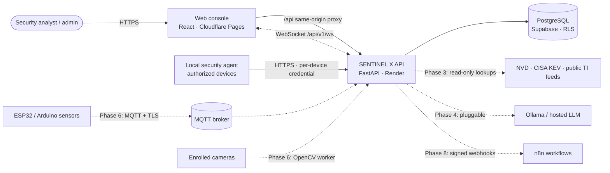
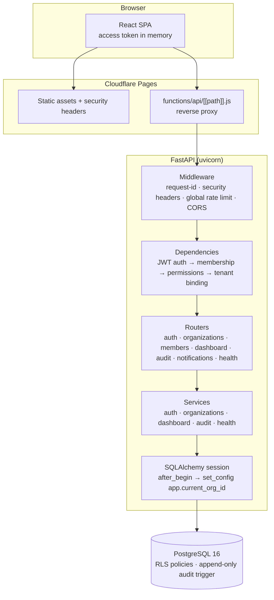
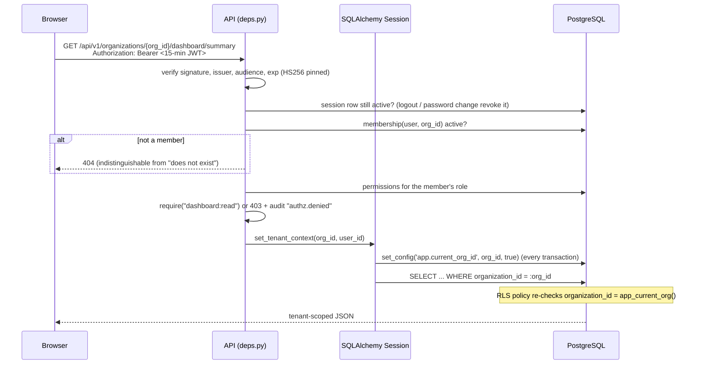
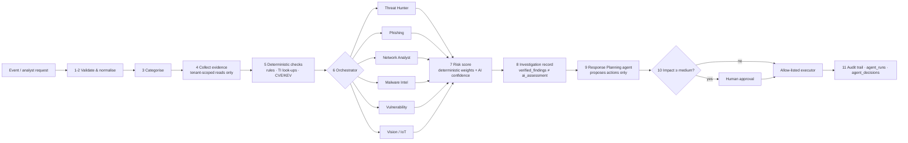
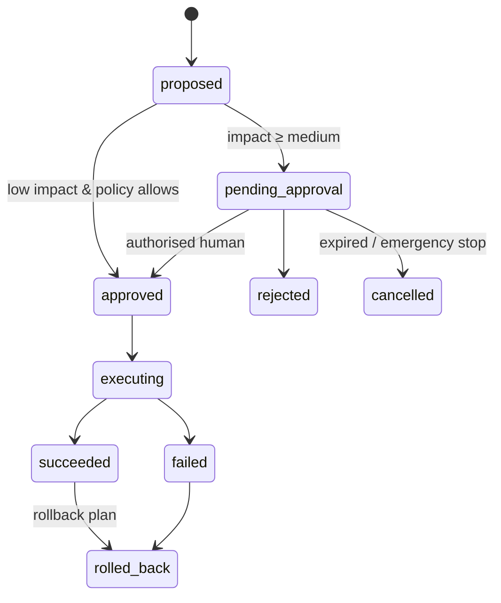
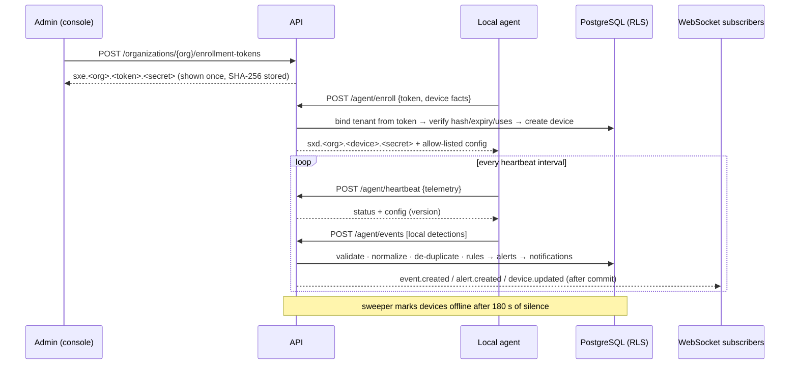

# Architecture — SENTINEL X · AEGIS NEXUS

> One intelligent platform. Complete digital awareness. Autonomous defense — with a human in the loop.

This document is the system design for the whole platform. Sections marked **(implemented)** exist
in the code today; sections marked **(designed)** describe how later phases plug into the same
foundation. Nothing marked "designed" should be read as working functionality.

## 1. Design principles

1. **Tenant isolation is non-negotiable.** Every organization-owned row carries `organization_id`;
   access is resolved through the caller's membership *and* enforced again by PostgreSQL Row-Level
   Security (RLS).
2. **Deterministic first, AI second.** Rules and trusted intelligence produce verified findings; AI
   adds explanation and prioritisation, and its output is always labelled as AI-generated.
3. **Humans approve impact.** Any action that changes a system (block, isolate, disable) is a
   *proposal* until an authorised human approves it. Everything is audited.
4. **Honest data.** No fake counters. Simulated/demo records carry `is_simulated = true` and are
   excluded from real metrics.
5. **Free to run, ready to scale.** SQLite or Docker locally; Supabase + Render + Cloudflare Pages
   free tiers in the cloud; each piece swappable for paid infrastructure without code changes.

## 2. System context



## 3. Runtime components (implemented)



### Request lifecycle and tenant binding



### Authentication model (implemented)

| Element | Design |
|---|---|
| Password storage | Argon2id (`argon2-cffi`), automatic rehash on parameter upgrades |
| Access token | HS256 JWT, 15 minutes, `iss`/`aud`/`typ`/`sid` claims, kept **only in memory** in the browser |
| Refresh token | 384-bit random, stored as SHA-256 hash, HttpOnly cookie scoped to `/api/v1/auth`, rotated on every use |
| Theft detection | Replay of a rotated token (outside a 20 s multi-tab grace window) revokes the whole session family |
| CSRF | Cookie endpoints require `X-Requested-With: sentinel-x` (forces a CORS preflight) |
| Brute force | Per-IP and per-account rate limits, account lockout after 5 failures (15 min) |
| Session control | Logout, sign-out-everywhere, password change revokes other sessions |

## 4. Module map

| # | Module | Pillar | Phase | Status |
|---|---|---|---|---|
| 1 | Command Center | Overview | 1 | **Live** |
| 2 | AI Security Brain | SENTINEL X | 4 | Designed |
| 3 | Threat Intelligence Center | NEXUS ZERO | 3 | Designed |
| 4 | Network Security Monitor | NEXUS ZERO | 3 | Designed |
| 5 | Vulnerability Intelligence | NEXUS ZERO | 3 | Designed |
| 6 | Phishing & URL Analyzer | NEXUS ZERO | 3 | Designed |
| 7 | File & Hash Analyzer | NEXUS ZERO | 3 | Designed |
| 8 | Computer Vision Security | AEGIS ONE | 6 | Designed |
| 9 | IoT Device Security | AEGIS ONE | 6 | Designed |
| 10 | Digital Twin | AEGIS ONE | 7 | Designed |
| 11 | Device Management | AEGIS ONE | 2 | **Live** |
| 12 | Incident Response Center | SENTINEL X | 5 | Designed |
| 13 | Digital Forensics Lab | SENTINEL X | 5 | Designed |
| 14 | Autonomous Agent Center | SENTINEL X | 4 | Designed |
| 15 | Workflow Automation | SENTINEL X | 8 | Designed |
| 16 | Reports & Analytics | SENTINEL X | 5 | Designed |
| 17 | Organization Management | Admin | 1 | **Live** |
| 18 | User & Role Management | Admin | 1 | **Live** |
| 19 | System Settings | Admin | 1 | **Live** (status + account security) |
| 20 | Research Lab | Admin | 9 | Designed |
| — | Audit Log | Admin | 1 | **Live** |
| — | Security Events | SENTINEL X | 2 | **Live** |

Every module already has its database tables (tenant-isolated) and a navigation entry. Planned
modules render an explicit roadmap page with no interactive controls.

## 5. AI agent architecture (designed — Phase 4)



* **Provider abstraction**: `LLMProvider` interface with `none` (rules only), `ollama` (local,
  free) and hosted providers configured purely through environment variables.
* **Tooling boundary**: agents receive *read-only, tenant-scoped* tool functions (query events,
  look up an indicator). They cannot execute shell commands, open network connections to targets,
  or write anything except their own `agent_runs`/`agent_decisions` rows.
* **Prompt-injection posture**: event content is passed as data, never as instructions; agent
  output is parsed into a strict schema, and any proposed action is validated against an
  allow-list before it can even be shown for approval.

## 6. Autonomous defense engine (designed — Phase 5/8)



* Actions are an allow-list (`notify_admin`, `create_alert`, `block_indicator` via an explicitly
  configured firewall integration, `isolate_device` via an enrolled agent, `trigger_workflow` …).
* Each action stores a `rollback_plan`; the executor refuses actions without one when a rollback
  is possible.
* **Emergency stop**: an organization-level kill switch that cancels pending actions and disables
  automated execution until re-enabled by an owner.
* The local agent accepts only signed, allow-listed *configuration* messages — never commands.

## 7. Security Event Engine (implemented — Phase 2)



| Stage | Implementation |
|---|---|
| Authentication | Device credential parsed → organization bound to the DB session → device row looked up under RLS → constant-time hash compare. Per-device rate limit. |
| Validation | Pydantic schemas: allow-listed categories and severities, `event_type` pattern, ≤ 100 events/batch, `raw` ≤ 16 KB, timestamps ≤ 5 min in the future and ≤ 7 days old (rejected per item). |
| Normalization | ECS-inspired `normalized` document (`event.*`, `host.*`, `observables.*`) for rules, search and the Phase 4 orchestrator. |
| De-duplication | SHA-256 fingerprint of device + type + (dedup key or severity/title); repeats within 10 min increment `occurrence_count`. |
| Detection | Deterministic rules with names stored on each alert: `severity-threshold` (every new high/critical event) and `auth-bruteforce` (≥ 5 failed logins per device in 5 min, counting duplicates, one open alert at a time). |
| Response | Alerts notify every member holding `alerts:manage`; no automated actions in this phase. |
| Real-time | In-process hub; messages are queued on the SQLAlchemy session and published only after `COMMIT`. WebSocket clients authenticate with their access token in the first frame (never in the URL), the Origin must be an allowed console origin, and the session + membership are re-checked every 5 minutes. A cross-instance bus (Postgres LISTEN/NOTIFY or Redis) is needed before running several API instances. |
| Background work | `sweeper.run_forever()` lifespan task; visits organizations one at a time with the tenant bound so RLS also applies to the job. |

### Later phases (designed)

| Phase | Ingress | Validation | Storage |
|---|---|---|---|
| 3 | Analyst submits URL / hash / IP | strict parsers, SSRF-safe fetchers (no private IPs) | `investigations`, `threat_indicators`, `evidence` |
| 6 | MQTT (per-device credentials, TLS) and OpenCV worker | topic ACLs, schema | `sensors`, `cameras`, `security_events` |

## 8. Repository layout

```
sentinel-x-aegis-nexus/
├── backend/                     FastAPI service
│   ├── app/
│   │   ├── api/                 deps.py (auth, tenancy, RBAC) · v1/routes/*
│   │   ├── core/                config · security · errors · logging · middleware · rate_limit
│   │   ├── db/                  declarative base · session + RLS tenant binding
│   │   ├── models/              identity.py · operations.py (27 tables)
│   │   ├── rbac/                catalog.py (roles → permissions)
│   │   ├── schemas/             Pydantic request/response models
│   │   └── services/            auth · organizations · dashboard · audit · health ·
│   │                            devices · events (rules) · realtime (hub) · sweeper
│   ├── alembic/versions/        0001 initial schema (tables, RLS, trigger, seed) · 0002 devices & events
│   ├── scripts/                 start.sh · postgres/create_app_role.sql
│   ├── tests/                   pytest (SQLite + PostgreSQL/RLS)
│   └── Dockerfile
├── frontend/                    React + Vite + TypeScript + Tailwind
│   ├── src/
│   │   ├── auth/ · org/         session & tenant context, route guards
│   │   ├── realtime/            WebSocket provider, live toasts
│   │   ├── components/          ui/ (design system) · layout/ (shell, sidebar, palette)
│   │   ├── config/modules.ts    the 20-module catalogue
│   │   ├── lib/                 api client · types · formatting
│   │   └── pages/               auth · onboarding · dashboard · devices · events · org · audit · account · modules
│   ├── functions/api/           Cloudflare Pages reverse proxy
│   ├── e2e/                     Playwright end-to-end tests
│   └── Dockerfile · nginx.conf
├── agent/                       Python local security agent (sentinel-agent CLI) + tests
├── docker/postgres/             init script for the least-privileged DB role
├── docs/                        architecture · database · security · deployment · roadmap
├── docker-compose.yml · render.yaml
└── .github/workflows/ci.yml
```

## 9. Technology choices

| Concern | Choice | Why |
|---|---|---|
| API | FastAPI + Pydantic v2 | typed validation, OpenAPI, async-ready for WebSockets |
| ORM / migrations | SQLAlchemy 2 + Alembic | portable (SQLite dev, PostgreSQL prod), reviewable migrations |
| Database | PostgreSQL 16 (Supabase) | RLS, JSONB, mature hosting free tier |
| Auth | Built-in (Argon2id + JWT + rotating refresh) | no vendor lock-in; Supabase Auth can be added as an IdP later |
| Frontend | React 19, Vite, TypeScript, Tailwind v4, TanStack Query, Recharts | fast builds, typed API layer, cache-aware data fetching |
| Charts / 3D | Recharts (lazy-loaded); Three.js in Phase 7 | keep the initial bundle small |
| Hosting | Cloudflare Pages · Render · Supabase | all have free tiers; replaceable by any container / Postgres host |
