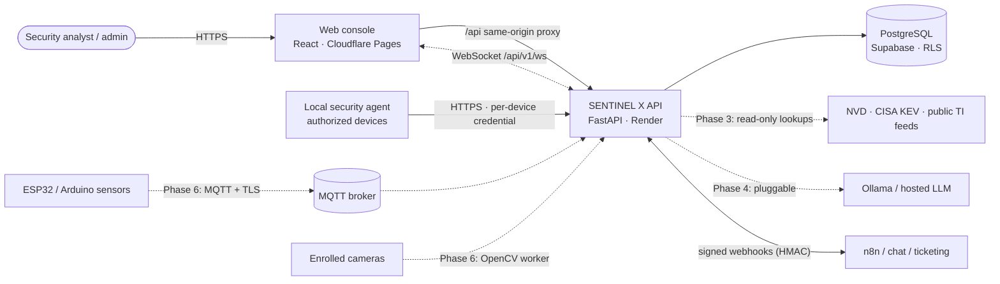
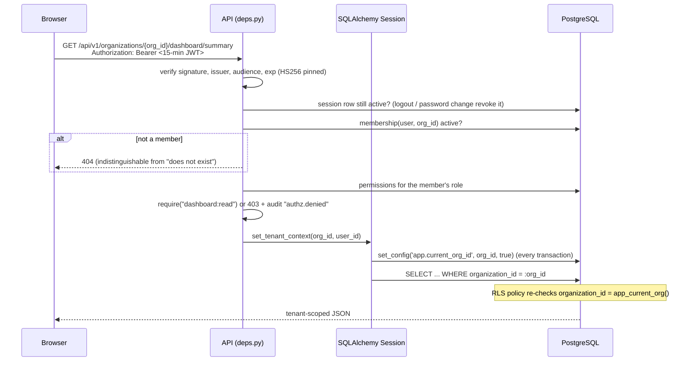
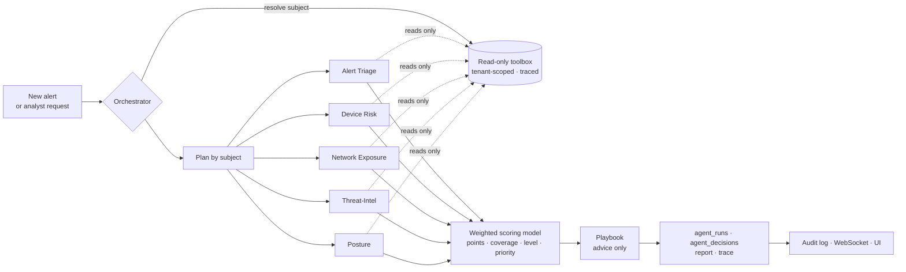
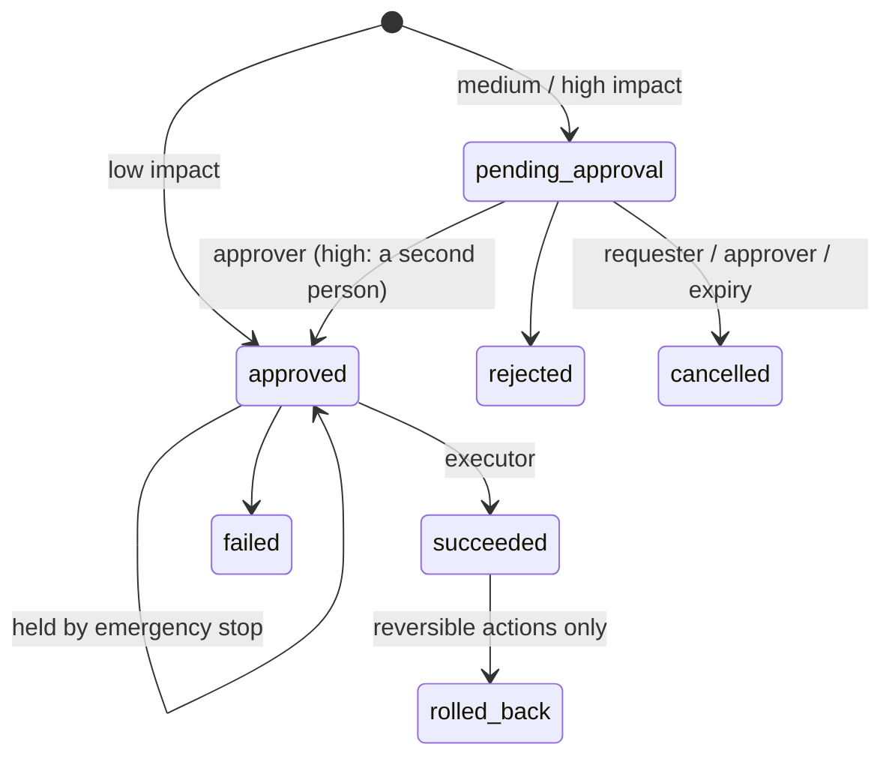
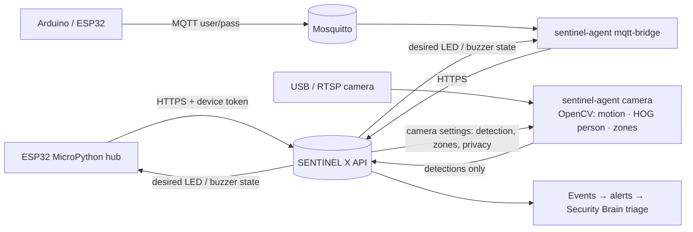
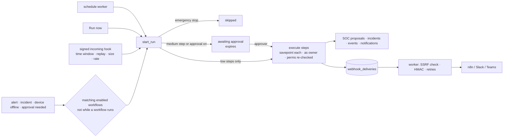
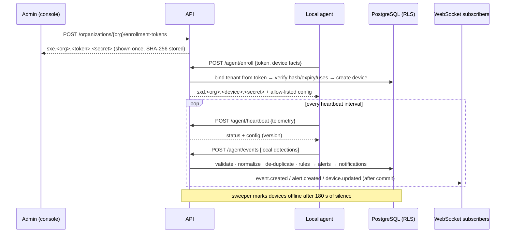
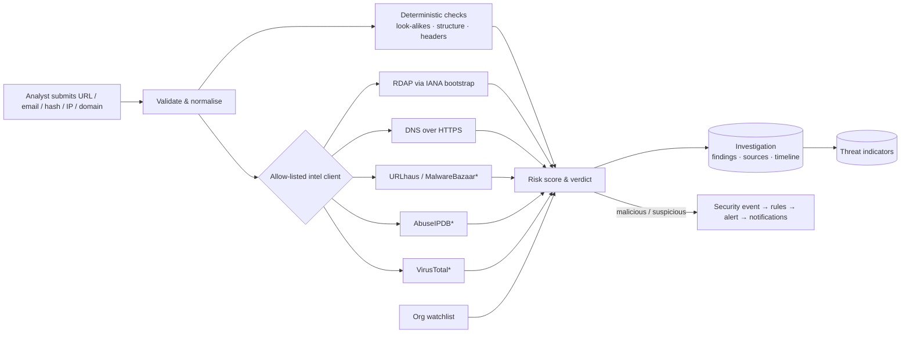

# Architecture — SENTINEL X · AEGIS NEXUS

> One intelligent platform. Complete digital awareness. Autonomous defense — with a human in the loop.

This document is the system design for the whole platform. Sections marked **(implemented)** exist
in the code today; sections marked **(designed)** describe how later phases plug into the same
foundation. Nothing marked "designed" should be read as working functionality.

## 1. Design principles

1. **Tenant isolation is non-negotiable.** Every organization-owned row carries `organization_id`;
   access is resolved through the caller's membership *and* enforced again by PostgreSQL Row-Level
   Security (RLS).
2. **Deterministic first, AI second.** Rules and trusted intelligence produce verified findings; AI
   adds explanation and prioritisation, and its output is always labelled as AI-generated.
3. **Humans approve impact.** Any action that changes a system (block, isolate, disable) is a
   *proposal* until an authorised human approves it. Everything is audited.
4. **Honest data.** No fake counters. Simulated/demo records carry `is_simulated = true` and are
   excluded from real metrics.
5. **Free to run, ready to scale.** SQLite or Docker locally; Supabase + Render + Cloudflare Pages
   free tiers in the cloud; each piece swappable for paid infrastructure without code changes.

## 2. System context



## 3. Runtime components (implemented)

```mermaid
flowchart TB
    subgraph Browser
      UI[React SPA<br/>access token in memory]
    end
    subgraph Edge["Cloudflare Pages"]
      static[Static assets + security headers]
      fn["functions/api/[[path]].js<br/>reverse proxy"]
    end
    subgraph API["FastAPI (uvicorn)"]
      mw[Middleware<br/>request-id · security headers · body limits · rate limits (Redis or in-process) · CORS]
      deps[Dependencies<br/>JWT auth → membership → permissions → tenant binding]
      routes[Routers<br/>auth · organizations · members · dashboard · audit · notifications · health]
      svc[Services<br/>auth · organizations · dashboard · audit · health]
      orm[SQLAlchemy session<br/>after_begin → set_config app.current_org_id]
    end
    PG[(PostgreSQL 16<br/>RLS policies · append-only audit trigger)]
    UI --> static
    UI --> fn --> mw --> deps --> routes --> svc --> orm --> PG
```

### Request lifecycle and tenant binding



### Authentication model (implemented)

| Element | Design |
|---|---|
| Password storage | Argon2id (`argon2-cffi`), automatic rehash on parameter upgrades |
| Access token | HS256 JWT, 15 minutes, `iss`/`aud`/`typ`/`sid` claims, kept **only in memory** in the browser |
| Refresh token | 384-bit random, stored as SHA-256 hash, HttpOnly cookie scoped to `/api/v1/auth`, rotated on every use |
| Theft detection | Replay of a rotated token (outside a 20 s multi-tab grace window) revokes the whole session family |
| CSRF | Cookie endpoints require `X-Requested-With: sentinel-x` (forces a CORS preflight) |
| Brute force | Per-IP and per-account rate limits, account lockout after 5 failures (15 min) |
| Session control | Logout, sign-out-everywhere, password change revokes other sessions |

## 4. Module map

| # | Module | Pillar | Phase | Status |
|---|---|---|---|---|
| 1 | Command Center | Overview | 1 | **Live** |
| 2 | Security Brain | SENTINEL X | 4 | **Live** (deterministic) |
| 3 | Threat Intelligence Center | NEXUS ZERO | 3 | **Live** |
| 4 | Network Security Monitor | NEXUS ZERO | 3 | **Live** |
| 5 | Vulnerability Intelligence | NEXUS ZERO | 3 | **Live** |
| 6 | Phishing & URL Analyzer | NEXUS ZERO | 3 | **Live** |
| 7 | File & Hash Analyzer | NEXUS ZERO | 3 | **Live** |
| 8 | Computer Vision Security | AEGIS ONE | 6 | **Live** |
| 9 | IoT Device Security | AEGIS ONE | 6 | **Live** |
| 10 | Digital Twin | AEGIS ONE | 7 | **Live** |
| 11 | Device Management | AEGIS ONE | 2 | **Live** |
| 12 | Incident Response Center | SENTINEL X | 5 | **Live** |
| 13 | Digital Forensics Lab | SENTINEL X | 5 | **Live** |
| 14 | Agent Center | SENTINEL X | 4 | **Live** |
| 15 | Workflow Automation | SENTINEL X | 8 | **Live** |
| 16 | Reports & Analytics | SENTINEL X | 5 | **Live** |
| 17 | Organization Management | Admin | 1 | **Live** |
| 18 | User & Role Management | Admin | 1 | **Live** |
| 19 | System Settings | Admin | 1 | **Live** (status + account security) |
| 20 | Research Lab | NEXUS ZERO | 9 | **Live** |
| — | Audit Log | Admin | 1 | **Live** |
| — | Security Events | SENTINEL X | 2 | **Live** |

Every module already has its database tables (tenant-isolated) and a navigation entry. Planned
modules render an explicit roadmap page with no interactive controls.

## 5. Security Brain (implemented — Phase 4)



| Subject | Agents | Scoring factors (max points) |
|---|---|---|
| `alert` | triage, device, exposure, intel | severity 50 · corroboration 15 · device condition 10 · exposure 10 · threat intel 15 |
| `device` | device, exposure, intel | state 20 · open alerts 30 · event activity 15 · exposure 20 · threat intel 15 |
| `organization` | posture, exposure, intel | open alerts 30 · backlog 10 · fleet health 20 · exposure 20 · threat intel 20 |

* **Engine**: `AI_PROVIDER=none` is the only value accepted, so the platform can never silently
  claim an AI model analysed data. Decisions are stored with `is_ai_generated = false`. A future
  model provider would only add narrative text, stored and labelled separately; it would never
  replace scores, findings or evidence.
* **Tool boundary** (`app/brain/toolbox.py`): agents receive a `Toolbox`, never the session. Every
  query filters on the run's organization (RLS is the second wall). Tools return plain dictionaries,
  run with autoflush off, and the run is aborted if the session gains pending changes. A static
  test forbids writes, raw SQL, shell, and network imports in tools and agents. Each call is
  traced with named arguments, row count and duration.
* **Scoring** (`app/brain/scoring.py`): fixed models that total 100 points. A factor without
  input data scores 0 and lowers the reported **coverage**, so a quiet result with low coverage
  reads as "unknown", not "safe". Levels: critical 75+, high 50+, medium 25+, low 10+; alert
  priority is P1-P4.
* **Automatic triage**: event ingestion analyses each new alert inside a savepoint; errors are
  logged and never block ingestion (`BRAIN_AUTO_TRIAGE`).
* **Outputs**: a run stores the factor breakdown, findings with evidence references, playbook
  recommendations (system-changing ones are flagged for human approval — nothing is executed), the
  tool trace and a Markdown report. A device's latest score is written to `devices.risk_score`; an
  alert keeps its detection score, and the latest triage is shown next to it.

## 6. Controlled response (implemented — Phase 5)



| Action | Impact | What it changes | Rollback |
|---|---|---|---|
| `notify_team` | low | in-app notifications to everyone with `alerts:manage` | — |
| `heighten_monitoring` | medium | the device's agent configuration (15 s heartbeat, all collectors) | previous configuration restored |
| `block_indicator` | medium | watchlist verdict → malicious + block-list export | previous verdict restored / indicator removed |
| `revoke_device` | high | device credential revoked, agent disconnected | not reversible (re-enroll) |
| `suspend_member` | high | membership suspended (API access ends at once) | membership reactivated |

* Executors only change data inside the platform; there is no shell, no network call and no third-party
  integration. Firewalls and DNS filters can import the block list themselves.
* `high` impact needs an approver other than the requester; an organization with a single approver may
  self-approve, and the approval is recorded as such. Pending approvals expire (`APPROVAL_TTL_HOURS`).
* **Emergency stop** (organization setting): every execution and rollback is held until an approver
  releases it; held actions are run explicitly afterwards.
* Every proposal, decision, execution and rollback is audited, broadcast in real time and added to the
  incident's append-only timeline. Executions run in a savepoint, so a failed action changes nothing.
* **Evidence**: bytes live in `evidence_blobs` (RLS) and are immutable; the hash, size and type of an
  evidence item and the start of its chain of custody cannot change (PostgreSQL triggers).
* The local agent still accepts only allow-listed *configuration* — never commands.

## 6b. AEGIS ONE — sensors and cameras (implemented — Phase 6)



* Hubs and camera agents are ordinary enrolled devices; sensors and cameras register on first report.
* Thresholds → `iot.threshold_breach` / `iot.threshold_recovered` events; actuators follow per-sensor
  rules or a timed manual override. Hubs receive *state*, never commands.
* Cameras start with detection **off**; video stays on site; there is no identity recognition.
  Snapshots require privacy mode off, are pixelated around people by default, expire with the
  camera's retention and are purged when privacy mode is turned back on.
* The simulator creates a credential-less, `is_simulated` hub, sensors and camera that the Command
  Center ignores.

## 6c. Digital Twin (implemented — Phase 7)

`GET /organizations/{id}/twin` builds one read model from existing records — devices (status, health,
Brain risk), open alerts and incidents per device (through the alert → event → device link),
attached sensors and cameras, and /24 (/64) segments derived from device addresses. The layout is
the only new data: rooms in `organizations.settings.twin.areas` and device coordinates in
`devices.location`, written by `PUT …/twin/layout` (`devices:manage`, audited). The console renders
it with Three.js in a lazily loaded chunk, and falls back to a room-by-room list when WebGL is
unavailable. Devices that were never placed are lined up along the front of the floor and labelled
"not placed".

## 6d. Automation (implemented — Phase 8)

A workflow is *one trigger + up to ten steps*, both chosen from allow-lists in
`app/automation/catalog.py`; definitions are validated on save (step ↔ trigger compatibility,
webhooks of the same organization only).



* **Runs** (`automation_runs`) keep the data-minimised trigger context, every step's result and
  the approval decision. They act as the workflow owner (or the person who pressed Run); saving a
  workflow takes ownership.
* **Outgoing webhooks** are an outbox: steps only queue rows inside the run's transaction; the
  automation worker (lifespan task, every `AUTOMATION_TICK_SECONDS`) sends them after commit, so
  rolled-back work never leaves the platform.
* **Secrets** are derived: `HMAC(AUTOMATION_SIGNING_KEY, kind:id:version)`. The database holds only
  the version; rotation bumps it.
* **Loop guard:** a context flag marks code running inside a workflow; events it causes do not
  trigger workflows, so SENTINEL X and n8n cannot ping-pong.

## 6e. Research Lab (implemented — Phase 9)

The lab answers "would this rule have been better than what we run today?" without touching
production. A **dataset** is a frozen, time-ordered copy of recorded events (or uploaded lab data)
with labels taken from analyst decisions — an alert closed as false positive makes its event
*benign*, a resolved alert or one linked to an incident makes it *malicious*. Its SHA-256 is stored
and a PostgreSQL trigger forbids edits. A **rule** is data only (`app/lab/rules.py`): conditions on
category, event type, severity, title, source or device, joined by *all* / *any*, with an optional
"N times within M minutes per device" threshold. Nothing is executed or interpolated. An
**experiment** scores the rule (precision, recall, F1, alerts per day, sample hits and misses)
next to the built-in severity rule, and stores the dataset hash, rule hash and engine version, so
`POST …/reproduce` can prove the result is unchanged.

## 7. Security Event Engine (implemented — Phase 2)



| Stage | Implementation |
|---|---|
| Authentication | Device credential parsed → organization bound to the DB session → device row looked up under RLS → constant-time hash compare. Per-device rate limit. |
| Validation | Pydantic schemas: allow-listed categories and severities, `event_type` pattern, ≤ 100 events/batch, `raw` ≤ 16 KB, timestamps ≤ 5 min in the future and ≤ 7 days old (rejected per item). |
| Normalization | ECS-inspired `normalized` document (`event.*`, `host.*`, `observables.*`) for rules, search and the Phase 4 orchestrator. |
| De-duplication | SHA-256 fingerprint of device + type + (dedup key or severity/title); repeats within 10 min increment `occurrence_count`. |
| Detection | Deterministic rules with names stored on each alert: `severity-threshold` (every new high/critical event) and `auth-bruteforce` (≥ 5 failed logins per device in 5 min, counting duplicates, one open alert at a time). |
| Response | Alerts notify every member holding `alerts:manage`; no automated actions in this phase. |
| Real-time | In-process hub; messages are queued on the SQLAlchemy session and published only after `COMMIT`. WebSocket clients authenticate with their access token in the first frame (never in the URL), the Origin must be an allowed console origin, and the session + membership are re-checked every 5 minutes. A cross-instance bus (Postgres LISTEN/NOTIFY or Redis) is needed before running several API instances. |
| Background work | `sweeper.run_forever()` lifespan task; visits organizations one at a time with the tenant bound so RLS also applies to the job. |

### Later phases (designed)

| Phase | Ingress | Validation | Storage |
|---|---|---|---|
| 3 | Analyst submits URL / hash / IP | strict parsers, SSRF-safe fetchers (no private IPs) | `investigations`, `threat_indicators`, `evidence` |
| 6 | MQTT (per-device credentials, TLS) and OpenCV worker | topic ACLs, schema | `sensors`, `cameras`, `security_events` |

## 8. NEXUS ZERO threat intelligence (implemented — Phase 3)


`*` optional, enabled by an API key. CVE data comes from the CISA KEV feed (bulk) and NVD (on demand, cached 7 days).

| Rule | Implementation |
|---|---|
| Never touch the subject | URLs, domains and IPs are only *looked up*; the HTTP client refuses any host not on the provider allow-list (RDAP servers are added only from IANA's bootstrap file), HTTPS only, no redirects, 8 MB cap. |
| Provenance | Each finding records `source` and `kind`: `intel` (an external source or the org's watchlist said so), `heuristic` (a local deterministic rule) or `context` (neutral fact). The UI shows them in separate columns. |
| Honesty | Every source is listed as consulted, not configured, unavailable or skipped. Without positive evidence the verdict is "No known threat found", never "safe". |
| Scoring | Sum of finding weights capped at 100; any high/critical `intel` finding sets the floor at 85 and the verdict to malicious; ≥ 70 malicious, ≥ 35 suspicious. |
| AI | Not used. The Security Brain (Phase 4) is deterministic; `ai_assessment` stays empty while no AI model is configured. |
| Network scope | The platform never scans. Operators import their own Nmap XML; hosts outside declared scopes are discarded; scopes larger than /16 (/48 IPv6) are refused; public ranges need an explicit authorization attestation (audited). |

## 9. Repository layout

```
sentinel-x-aegis-nexus/
├── backend/                     FastAPI service
│   ├── app/
│   │   ├── api/                 deps.py (auth, tenancy, RBAC) · v1/routes/*
│   │   ├── core/                config · security · errors · logging · middleware · rate_limit
│   │   ├── aegis/               AEGIS ONE: iot (readings, thresholds, actuators) · vision ·
│   │   │                        simulator · twin (read model + layout)
│   │   ├── automation/          workflows: catalog · engine · signing · targets (SSRF) · delivery · worker
│   │   ├── soc/                 SOC: incidents · actions (allow-list, approvals, emergency stop) ·
│   │   │                        evidence (SHA-256, custody) · reports
│   │   ├── brain/               Security Brain: orchestrator · agents · toolbox (read-only) ·
│   │   │                        scoring · playbook · report · engine
│   │   ├── intel/               NEXUS ZERO: client (allow-list) · providers · url · domain · ip ·
│   │   │                        hashes · email_headers · lookalike · vulns (KEV/NVD) · findings
│   │   ├── db/                  declarative base · session + RLS tenant binding
│   │   ├── models/              identity.py · operations.py (27 tables)
│   │   ├── rbac/                catalog.py (roles → permissions)
│   │   ├── schemas/             Pydantic request/response models
│   │   └── services/            auth · organizations · dashboard · audit · health ·
│   │                            devices · events (rules) · realtime (hub) · sweeper
│   ├── alembic/versions/        0001 schema, RLS, trigger, seed · 0002 devices & events · 0003 intel ·
│   │                            0004 pinned search_path · 0005 Security Brain ·
│   │                            0006 SOC · 0007 AEGIS ONE
│   ├── scripts/                 start.sh · postgres/create_app_role.sql
│   ├── tests/                   pytest (SQLite + PostgreSQL/RLS)
│   └── Dockerfile
├── frontend/                    React + Vite + TypeScript + Tailwind
│   ├── src/
│   │   ├── auth/ · org/         session & tenant context, route guards
│   │   ├── realtime/            WebSocket provider, live toasts
│   │   ├── components/          ui/ (design system) · layout/ (shell, sidebar, palette)
│   │   ├── config/modules.ts    the 20-module catalogue
│   │   ├── lib/                 api client · types · formatting
│   │   └── pages/               auth · onboarding · dashboard · devices · events · org · audit · account · modules
│   ├── functions/api/           Cloudflare Pages reverse proxy
│   ├── e2e/                     Playwright end-to-end tests
│   └── Dockerfile · nginx.conf
├── agent/                       Python local security agent (sentinel-agent CLI: agent, camera, mqtt-bridge) + tests
├── firmware/micropython/        ESP32 sensor hub
├── integrations/n8n/           n8n guide + Node.js signature kit (tested against the Python signer)
├── docker/postgres/             init script for the least-privileged DB role
├── docs/                        architecture · database · security · deployment · roadmap
├── docker-compose.yml · render.yaml
└── .github/workflows/ci.yml
```

## 10. Technology choices

| Concern | Choice | Why |
|---|---|---|
| API | FastAPI + Pydantic v2 | typed validation, OpenAPI, async-ready for WebSockets |
| ORM / migrations | SQLAlchemy 2 + Alembic | portable (SQLite dev, PostgreSQL prod), reviewable migrations |
| Database | PostgreSQL 16 (Supabase) | RLS, JSONB, mature hosting free tier |
| Auth | Built-in (Argon2id + JWT + rotating refresh) | no vendor lock-in; Supabase Auth can be added as an IdP later |
| Frontend | React 19, Vite, TypeScript, Tailwind v4, TanStack Query, Recharts | fast builds, typed API layer, cache-aware data fetching |
| Charts / 3D | Recharts (lazy-loaded); Three.js in Phase 7 | keep the initial bundle small |
| Hosting | Cloudflare Pages · Render · Supabase | all have free tiers; replaceable by any container / Postgres host |
