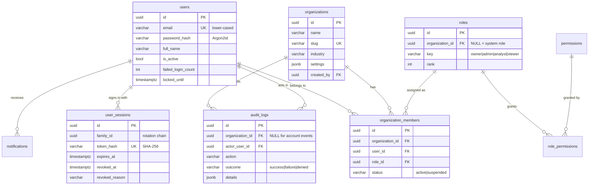
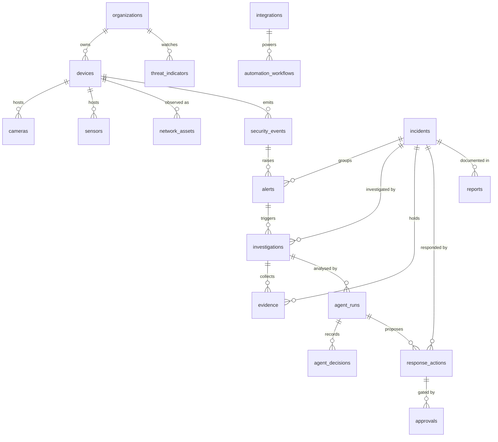

# Database design

PostgreSQL 16 in production (Supabase or any Postgres), SQLite for zero-install local development.
The schema is created by Alembic migration `0001_initial_schema` — 27 tables, plus the RLS
policies, an append-only audit trigger and the seeded system roles.

## Conventions

| Convention | Detail |
|---|---|
| Primary keys | `UUID` (v4), generated by the application |
| Timestamps | `timestamptz`; `created_at`/`updated_at` on mutable tables |
| Enumerations | `VARCHAR` + named `CHECK` constraints (portable, easy to extend in migrations) |
| Flexible data | `JSONB` on PostgreSQL (`JSON` on SQLite) for raw events, settings, evidence references |
| Tenancy | every organization-owned table has `organization_id … ON DELETE CASCADE` and an index starting with it |
| Demo data | `is_simulated BOOLEAN` on devices, cameras, sensors, events, alerts, incidents — excluded from real metrics |
| Secrets | never stored in plain text: passwords → Argon2id, refresh tokens → SHA-256, integration secrets → `secret_ref` (name of an env var / vault key) |
| Constraint names | deterministic naming convention (`pk_`, `fk_`, `uq_`, `ck_`, `ix_`) for reviewable migrations |

## Entity relationships

### Identity, tenancy and RBAC (used in Phase 1)



### Security operations (schema in place; populated from Phase 2 onwards)



## Table catalogue

| Group | Table | Purpose | Tenant-owned |
|---|---|---|---|
| Identity | `users` | accounts, lockout state | — |
| | `user_sessions` | refresh-token sessions with rotation families | — (user) |
| Tenancy | `organizations` | tenants | — |
| | `organization_members` | user ↔ org with role (unique per pair) | scoped in the API (RLS: `api_access`) |
| RBAC | `roles`, `permissions`, `role_permissions` | system roles (org-specific roles reserved) | — |
| Audit | `audit_logs` | append-only trail incl. failures & denials | ✔ |
| | `notifications` | per-user in-app notifications | user |
| AEGIS ONE | `devices` | enrolled assets, health, risk, location for the twin | ✔ |
| | `cameras` | camera config, privacy mode, zones, retention | ✔ |
| | `sensors` | IoT sensors, thresholds, last reading | ✔ |
| | `network_assets` | discovered hosts/services, `in_authorized_scope` flag | ✔ |
| SOC | `security_events` | normalised events with raw payload and fingerprint | ✔ |
| | `alerts` | detections, severity, risk score, assignment | ✔ |
| | `incidents` | incident lifecycle (`INC-…` references) | ✔ |
| NEXUS ZERO | `investigations` | URL/hash/IP/email investigations — `verified_findings` vs `ai_assessment` | ✔ |
| | `threat_indicators` | IOCs with source attribution and `is_verified` | ✔ |
| | `vulnerability_records` | global CVE cache from NVD / CISA KEV (public data) | — |
| Forensics | `evidence` | evidence items with SHA-256 and chain of custody | ✔ |
| AI | `agent_runs`, `agent_decisions` | every Security Brain run (subject, weighted factors, coverage, tool trace, report) and each decision, flagged `is_ai_generated` | ✔ |
| Response | `response_actions` | proposed/approved/executed actions + rollback plan | ✔ |
| | `approvals` | human approval records | ✔ |
| Automation | `integrations` | outgoing webhook destinations (URL, health; the signing secret is derived, never stored) | ✔ |
| | `automation_workflows` | allow-listed trigger + steps, approval flag, schedule, inbound secret version | ✔ |
| | `automation_runs` | every run: trigger context, step results, approval decision | ✔ |
| | `webhook_deliveries` | outbox of signed webhook calls with attempts and results | ✔ |
| Research | `lab_datasets` | frozen, hashed, labelled event copies (immutable) | ✔ |
| | `lab_experiments` | rule, hashes, engine version and scores of each backtest (immutable) | ✔ |
| Reporting | `reports` | generated reports, AI sections flagged | ✔ |

## Row-Level Security

Installed by the migration on PostgreSQL only:

```sql
-- Helpers read transaction-local settings written by the API for each request.
app_current_org()   → current_setting('app.current_org_id')::uuid
app_current_user()  → current_setting('app.current_user_id')::uuid
app_api_context()   → current_setting('app.current_context') = 'api'

-- 17 tenant tables (devices … reports):
CREATE POLICY tenant_isolation ON <table>
  USING (organization_id = app_current_org())
  WITH CHECK (organization_id = app_current_org());

-- identity/shared tables: visible only inside an API transaction
CREATE POLICY api_access ON users USING (app_api_context()) WITH CHECK (app_api_context());

-- audit_logs: SELECT per tenant, INSERT only, no UPDATE/DELETE policy at all
-- notifications: rows visible only to the addressed user
```

All tables use `FORCE ROW LEVEL SECURITY`. RLS is **only effective when the API connects as a
role that is neither superuser nor `BYPASSRLS`** — create it with
`backend/scripts/postgres/create_app_role.sql` (Docker Compose does this automatically). The
Command Center's *System health* panel reports the live posture: `Enforced`,
`Bypassed by DB role`, or `N/A (SQLite dev)`.

Additional hardening in the migration:

* `audit_logs_append_only` trigger rejects any UPDATE (except the FK nulling a deleted user);
* every function in `public` has a pinned `search_path` (`0004`), so an object created earlier on
  a caller's path cannot shadow `current_setting()` and subvert a policy (Supabase lint 0011);
* on Supabase, all privileges are revoked from the `anon` and `authenticated` Data-API roles so the
  tables are never reachable through the public REST endpoint.

The automated test-suite runs every API test against PostgreSQL **as the least-privileged role**,
and `tests/test_rls.py` proves that a query *without* a `WHERE organization_id` clause still only
returns the current tenant's rows, that cross-tenant inserts fail, and that audit rows cannot be
modified.

## Migrations

```bash
# apply (uses MIGRATION_DATABASE_URL if set, else DATABASE_URL)
alembic upgrade head
# roll back everything (development only!)
alembic downgrade base
# create a new migration after changing models
alembic revision --autogenerate -m "describe change"
```

Every migration also renders offline (`alembic upgrade <from>:<to> --sql`), which is how SQL is
applied through Supabase's SQL Editor when there is no direct connection.

| Revision | Contents |
|---|---|
| `0001` | identity, tenancy, RBAC seed, operational tables, RLS, audit trigger, Data-API revokes |
| `0002` | device enrollment tokens and event-ingestion columns |
| `0003` | network scopes, investigation timeline/details, intel and network permissions |
| `0004` | pinned `search_path` on the RLS helper and audit trigger functions |
| `0009` | Research Lab: `lab_datasets` and `lab_experiments` (RLS, immutability trigger), `lab:read` / `lab:run` permissions |
| `0008` | Automation: `automation_runs` and `webhook_deliveries` (RLS), workflow steps / inbound secret version / next run / last status, integration secret version / failure count / last error, status and trigger CHECKs, `automation:read` permission |
| — | Phase 7 (Digital Twin) needs no migration: rooms live in `organizations.settings`, positions in `devices.location` |
| `0007` | AEGIS ONE: `sensor_readings` and `camera_snapshots` (RLS), sensor key / actuator rules / breach state, camera key / blur / last event, retention bounds |
| `0006` | SOC: `incidents.timeline` and unique reference, `alerts.acknowledged_at`, response action title/reason/reversible and allow-listed type, evidence title/filename/content type, `evidence_blobs` (RLS), immutability triggers |
| `0005` | Security Brain: `agent_runs` subject, creator, risk score/level, coverage, factors, trace and report; `agent_decisions` agent and severity; permissions `brain:read` / `brain:run` |

Migrations never import application models for data changes (seed data is frozen inside the
migration), so old migrations keep working as the models evolve. A test asserts the seeded
permissions still match `app/rbac/catalog.py`.
