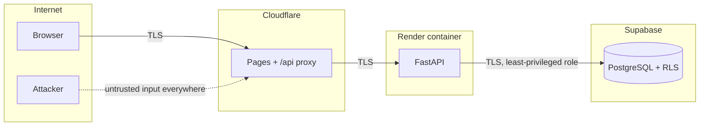

# Security architecture & threat model

SENTINEL X is a security product, so its own security model is a feature. This document lists the
assets, trust boundaries, threats (STRIDE) and the controls that exist **today** versus those
scheduled for later phases.

## Responsible-use boundaries (product rules)

* Monitoring, scanning and response only on **systems the organization owns or is authorised to
  test**; network scanning will be locked to explicitly declared private scopes.
* **No** internet-wide scanning, exploitation of third-party systems, attacks on public IPs,
  destructive actions, or unrestricted remote shells — not even for administrators.
* AI agents propose; **humans approve** anything with impact. Every decision is audited.
* Threat-intelligence verdicts are shown with their source. AI assessments are labelled and kept in
  separate fields from verified findings. The platform never invents intelligence results.
* Computer vision detects motion/objects/zones; it does **not** identify people.

## Assets

| Asset | Why it matters |
|---|---|
| Tenant security data (events, incidents, evidence) | confidentiality between organizations; integrity for investigations |
| Credentials (passwords, refresh tokens, device secrets) | account takeover, impersonation |
| Audit trail | accountability, forensics, compliance |
| Response capabilities (Phase 5+) | misuse could disrupt customer systems |
| AI provider keys / integration secrets | cost abuse, data exfiltration |

## Trust boundaries

## STRIDE analysis (Phase 1 scope)

| Threat | Example | Controls (implemented) |
|---|---|---|
| **S**poofing | credential stuffing, brute force | Argon2id; per-IP + per-account rate limits; lockout after 5 failures; generic "invalid email or password" (no user enumeration); timing equalised for unknown users |
| | forged / tampered JWT | HS256 pinned server-side (no `alg` trust, `none` rejected), `iss`/`aud`/`typ` required, 15-min expiry; tested |
| | stolen refresh token | HttpOnly + Secure cookie, path-scoped; rotation on each use; replay outside a 20 s grace window revokes the entire session family; tested |
| **T**ampering | cross-tenant writes | membership-resolved org context + RLS `WITH CHECK`; tested at API and DB level |
| | audit log tampering | no UPDATE/DELETE RLS policy; append-only trigger blocks even the table owner; tested |
| | mass assignment | explicit Pydantic request models; `extra` fields ignored; server sets owner/role fields |
| **R**epudiation | "I never changed that role" | audit entries for register, login (success/failure/locked), logout, refresh-reuse, password change, org create/update, member add/role-change/remove/leave, and every permission denial — with IP, user-agent and request ID |
| **I**nformation disclosure | probing other orgs' IDs | non-members receive the same 404 as for non-existent orgs |
| | forgotten `WHERE organization_id` | PostgreSQL RLS returns zero foreign rows; tested with raw SQL |
| | Supabase Data API exposure | migration revokes `anon`/`authenticated` privileges; identity tables additionally gated by `app.current_context` |
| | verbose errors | uniform error envelope, stack traces only in server logs, request IDs for correlation |
| | token theft via XSS | access token never persisted (memory only); refresh token unreadable by JS; strict CSP on the console (`script-src 'self'`) |
| **D**enial of service | login floods, API floods | auth and global rate limits (in-process; Redis-backed for multi-instance is planned); request validation limits (lengths, pagination caps) |
| **E**levation of privilege | analyst adds themselves as owner | DB-backed RBAC on every route; nobody may assign or modify a role ranked above their own; last owner cannot be removed or demoted; tested |
| | CSRF on cookie endpoints | `X-Requested-With` header requirement (forces CORS preflight), credentialed CORS restricted to configured origins, `SameSite` cookies |

## Controls inventory

| Area | Control | Status |
|---|---|---|
| Transport | HSTS (production), TLS via Cloudflare/Render/Supabase | ✔ |
| Headers | API: `nosniff`, `DENY` framing, `no-referrer`, CSP `default-src 'none'`, `no-store`; Console: CSP, `nosniff`, `DENY`, Permissions-Policy | ✔ |
| Config | refuses to start in production with a weak/placeholder `JWT_SECRET`, SQLite, insecure cookies or wildcard CORS | ✔ |
| Secrets | environment variables only; `.env` git-ignored; integration secrets referenced by name | ✔ |
| Logging | structured JSON logs with request IDs; no passwords/tokens logged | ✔ |
| Containers | non-root user, slim base image, health checks | ✔ |
| Supply chain | pinned dependency versions, lockfile (`npm ci`), CI lint + tests on every push | ✔ |
| Email verification / password reset | requires an email provider | Phase 10 |
| MFA (TOTP / WebAuthn) | | Planned (post Phase 5) |
| Distributed rate limiting (Redis) | | Planned (scale-out) |
| Device authentication & signed telemetry | per-device credentials, HMAC | Phase 2 |
| SSRF-safe fetchers for URL analysis | deny private/link-local ranges, size/time limits, no redirects to internal hosts | Phase 3 |
| Response engine safety | allow-list, approvals, rollback plans, emergency stop | Phase 5 |

## Reporting a vulnerability

Please do not open public issues for security problems. Email the maintainer privately with steps
to reproduce; you will receive an acknowledgement and a fix timeline.
