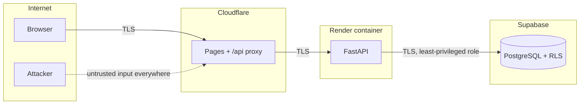

# Security architecture & threat model

SENTINEL X is a security product, so its own security model is a feature. This document lists the
assets, trust boundaries, threats (STRIDE) and the controls that exist **today** versus those
scheduled for later phases.

## Responsible-use boundaries (product rules)

* Monitoring, scanning and response only on **systems the organization owns or is authorised to
  test**; network scanning will be locked to explicitly declared private scopes.
* **No** internet-wide scanning, exploitation of third-party systems, attacks on public IPs,
  destructive actions, or unrestricted remote shells — not even for administrators.
* AI agents propose; **humans approve** anything with impact. Every decision is audited.
* Threat-intelligence verdicts are shown with their source. AI assessments are labelled and kept in
  separate fields from verified findings. The platform never invents intelligence results.
* Computer vision detects motion/objects/zones; it does **not** identify people.

## Assets

| Asset | Why it matters |
|---|---|
| Tenant security data (events, incidents, evidence) | confidentiality between organizations; integrity for investigations |
| Credentials (passwords, refresh tokens, device secrets) | account takeover, impersonation |
| Audit trail | accountability, forensics, compliance |
| Response capabilities (Phase 5+) | misuse could disrupt customer systems |
| AI provider keys / integration secrets | cost abuse, data exfiltration |

## Trust boundaries

## STRIDE analysis (Phase 1 scope)

| Threat | Example | Controls (implemented) |
|---|---|---|
| **S**poofing | credential stuffing, brute force | Argon2id; per-IP + per-account rate limits; lockout after 5 failures; generic "invalid email or password" (no user enumeration); timing equalised for unknown users |
| | forged / tampered JWT | HS256 pinned server-side (no `alg` trust, `none` rejected), `iss`/`aud`/`typ` required, 15-min expiry; tested |
| | stolen refresh token | HttpOnly + Secure cookie, path-scoped; rotation on each use; replay outside a 20 s grace window revokes the entire session family; tested |
| **T**ampering | cross-tenant writes | membership-resolved org context + RLS `WITH CHECK`; tested at API and DB level |
| | audit log tampering | no UPDATE/DELETE RLS policy; append-only trigger blocks even the table owner; tested |
| | mass assignment | explicit Pydantic request models; `extra` fields ignored; server sets owner/role fields |
| **R**epudiation | "I never changed that role" | audit entries for register, login (success/failure/locked), logout, refresh-reuse, password change, org create/update, member add/role-change/remove/leave, and every permission denial — with IP, user-agent and request ID |
| **I**nformation disclosure | probing other orgs' IDs | non-members receive the same 404 as for non-existent orgs |
| | forgotten `WHERE organization_id` | PostgreSQL RLS returns zero foreign rows; tested with raw SQL |
| | Supabase Data API exposure | migration revokes `anon`/`authenticated` privileges; identity tables additionally gated by `app.current_context` |
| | verbose errors | uniform error envelope, stack traces only in server logs, request IDs for correlation |
| | token theft via XSS | access token never persisted (memory only); refresh token unreadable by JS; strict CSP on the console (`script-src 'self'`) |
| **D**enial of service | login floods, API floods, huge bodies | auth and global rate limits (Redis-backed across instances when `REDIS_URL` is set); request body limits before parsing; validation limits (lengths, pagination caps) |
| **E**levation of privilege | analyst adds themselves as owner | DB-backed RBAC on every route; nobody may assign or modify a role ranked above their own; last owner cannot be removed or demoted; tested |
| | CSRF on cookie endpoints | `X-Requested-With` header requirement (forces CORS preflight), credentialed CORS restricted to configured origins, `SameSite` cookies |

## Controls inventory

| Area | Control | Status |
|---|---|---|
| Transport | HSTS (production), TLS via Cloudflare/Render/Supabase | ✔ |
| Headers | API: `nosniff`, `DENY` framing, `no-referrer`, CSP `default-src 'none'`, `no-store`; Console: CSP, `nosniff`, `DENY`, Permissions-Policy | ✔ |
| Config | refuses to start in production with a weak/placeholder `JWT_SECRET`, SQLite, insecure cookies or wildcard CORS | ✔ |
| Secrets | environment variables only; `.env` git-ignored; integration secrets referenced by name | ✔ |
| Logging | structured JSON logs with request IDs; no passwords/tokens logged | ✔ |
| Containers | non-root user, slim base image, health checks | ✔ |
| Supply chain | pinned dependency versions, lockfile (`npm ci`), CI lint + tests on every push | ✔ |
| Email verification / password reset | requires an email provider | Phase 10 |
| MFA (TOTP / WebAuthn) | | Planned (post Phase 5) |
| Distributed rate limiting (Redis) | `app/core/rate_limit.py` | ✅ Phase 9 |
| Device authentication | per-device credentials over HTTPS, rotation, revocation | ✔ (Phase 2) |
| Signed requests / mTLS for agents | defence in depth beyond TLS + bearer credential | Planned |
| SSRF-safe fetchers for URL analysis | deny private/link-local ranges, size/time limits, no redirects to internal hosts | Phase 3 |
| Response engine safety | allow-list, approvals, rollback plans, emergency stop | Phase 5 |

## Phase 2 additions: devices, agent and real-time stream

| Threat | Example | Control (implemented, tested) |
|---|---|---|
| Spoofed device | attacker posts events as a device | per-device 256-bit secret, only SHA-256 stored, constant-time compare; revoke/rotate; generic 401 |
| Cross-tenant device access | swapping the organization part of a credential | the organization in the credential selects the RLS tenant *before* lookup; a device id from another org is simply invisible (`test_device_token_cannot_cross_tenants`) |
| Stolen enrollment token | reused to enroll rogue machines | short expiry (≤ 7 days), max-use counter with row lock, revocable, every attempt audited (denied attempts included) |
| Remote code execution via the agent | server or MITM tells the agent to run something | the agent has no execution primitive at all (AST scan test forbids `subprocess`, `os.system`, `eval`, `exec`, …); config is an allow-list on **both** sides; HTTPS with certificate verification is mandatory for remote servers |
| Payload abuse / storage exhaustion | huge or endless events | ≤ 100 events per batch, `raw` ≤ 16 KB, bounded telemetry lists, per-device rate limit, de-duplication |
| Event timestamp manipulation | back-dated or future events to hide activity | rejected outside −7 days / +5 minutes; `ingested_at` is always server time |
| Cross-site WebSocket hijacking | evil page opens `/api/v1/ws` with the victim's cookies | the stream ignores cookies: the access token must be sent in the first message, and the Origin must be an allowed console origin |
| Token leakage via URLs/logs | token in `?token=` | never placed in URLs; first-frame authentication only |
| Stale stream after logout/removal | revoked user keeps receiving events | session family and membership re-checked every 5 minutes (closes with 4401/4403) |
| Leaking rolled-back data | broadcast before commit | broadcasts are queued on the DB session and published only after `COMMIT` |

## Phase 3 additions: threat intelligence and network monitor

| Threat | Example | Control (implemented, tested) |
|---|---|---|
| SSRF through investigations | "investigate" `http://169.254.169.254/` or an internal host | the subject is never requested; the intel client only talks HTTPS to allow-listed provider hosts, without redirects |
| Malicious XML upload | billion-laughs / XXE in an "Nmap report" | parsed with `defusedxml` (entities rejected), 5 MB and 4,096-host limits |
| Unauthorized scanning | importing or targeting someone else's network | the platform has no scanner; imports keep only hosts inside declared scopes; scopes ≤ /16, public ranges require an audited attestation |
| Hostile content from intel sources | script in a returned description or link | React escapes all text; external links are `https`-only and open with `rel="noopener noreferrer nofollow"` |
| Abuse / quota exhaustion of provider keys | scripted investigations | per-user investigation rate limit (20/min), KEV refresh throttled to once per 10 minutes |
| Leaking API keys | keys in code, logs or the browser | keys only in server environment variables; never returned by the API (only "configured: yes/no") |
| Privacy of analysed files | uploading confidential documents | files are hashed in the browser; only the SHA-256 is sent |
| Automation overruling analysts | an investigation flipping a watchlist verdict | analyst-set indicators are never modified by automated results |

## Phase 4 additions: Security Brain

| Threat | Example | Control (implemented, tested) |
|---|---|---|
| Agent overreach | an analysis step changes data, runs a command or calls out | agents get a read-only toolbox, not the session; tools return plain data; pending writes abort the run; a static test forbids write methods, raw SQL, shell and network imports |
| Cross-tenant analysis | analysing another organization's alert or device by ID | the subject is resolved through the toolbox with the run's organization filter and RLS → 404 |
| Overstated confidence | a quiet result read as "safe" when data was missing | factors without data score 0 and lower the reported coverage; the UI and report say the score is a lower bound |
| Pretending AI was used | an engine label or text implying a model | `AI_PROVIDER` accepts only `none`; decisions carry `is_ai_generated = false`; the UI labels the engine "deterministic — no AI model" |
| Automated response without approval | a recommendation is acted on automatically | recommendations are text only; system-changing ones are flagged "requires human approval"; nothing is executed in this phase |
| Analysis breaking detection | a Brain error drops events | automatic triage runs in a savepoint; failures are logged and ingestion continues |
| Abuse / load | scripted analyses | per-user limit (`RATE_LIMIT_BRAIN_PER_MINUTE`, 30/min); tools cap rows (≤ 500 events, ≤ 2,000 assets) |

## Phase 5 additions: SOC response and evidence

| Threat | Example | Control (implemented, tested) |
|---|---|---|
| Uncontrolled automation | an action runs without anyone deciding | fixed allow-list; medium/high impact waits for an approver; approvals expire |
| One person acting alone | an analyst approves their own revocation | high impact needs a second approver (single-approver organizations are recorded as self-approved); proposing and approving are separate permissions |
| Runaway response | a bad action keeps firing | emergency stop holds every execution and rollback; reversible actions store a rollback plan |
| Lock-out / abuse of suspension | suspending yourself, a higher role or the last owner | guarded at proposal **and** at execution time |
| Blocking your own network | putting an internal IP on the block list | private, loopback, link-local and multicast addresses are rejected |
| Evidence tampering | editing a stored file or rewriting custody | blobs immutable and hash/size/type/custody guarded by database triggers; every download and verification is a custody entry |
| Hostile evidence files | a script or executable uploaded as evidence | never executed or rendered; downloads are `application/octet-stream` + `nosniff` + `attachment`, filenames sanitised; 5 MB limit |
| Cross-tenant access | rolling back another organization's action | every lookup is scoped to the caller's organization (404) with RLS underneath |

## Phase 6 additions: sensors and cameras

| Threat | Example | Control (implemented, tested) |
|---|---|---|
| Remote control of hardware | a compromised server or response tells a board to run code | hubs receive only `led` / `buzzer` on/off state; the firmware ignores anything else and executes nothing |
| Surveillance creep | cameras streaming video or recognising people | detections only, no identity recognition; detection off for new cameras; snapshots opt-in, people pixelated, retention + deletion, views audited |
| Leaking camera credentials | an RTSP password stored in the cloud | the camera source stays on the local machine (environment variable), never sent |
| Hostile payloads | malformed MQTT messages or fake "images" | strict topic/key/value validation, size limits; snapshots must be JPEG/PNG under 1 MB |
| Unauthenticated sensors | anyone on the LAN publishing readings | Mosquitto profile refuses anonymous clients; hubs need their own device credential |
| Fake data passed off as real | simulator readings in reports | `is_simulated` on every simulated record, labelled in the UI, excluded from metrics |
| Weak TLS on microcontrollers | MicroPython does not verify certificates | documented; use trusted networks or the MQTT bridge (which verifies certificates) |

## Phase 7 additions: Digital Twin

| Threat | Example | Control (implemented, tested) |
|---|---|---|
| Layout tampering | a viewer moving devices or rooms | `PUT /twin/layout` needs `devices:manage` and is audited |
| Hiding real data as "simulated" | a client marking a real room as simulator data so it disappears | the simulated flag is set by the server only |
| Cross-tenant map data | positioning another organization's device | device lookups are scoped to the caller's organization (404), RLS underneath |

## Phase 8 additions: Automation and webhooks

| Threat | Example | Control (implemented, tested) |
|---|---|---|
| Automation acting without a human | a workflow opening incidents or blocking on its own | allow-listed steps only; medium-risk steps always need an approver; blocks are only *proposed* to the SOC queue (Phase 5 approval rules); approvals expire |
| Self-approval | a member starts a run and approves it | refused unless they are the only approver; self-approval is recorded |
| Forged or replayed incoming hooks | an attacker posting to the hook URL | HMAC-SHA256 over timestamp + raw body, constant-time compare, ±5 min window, one-time use per signature, 64 KB limit, per-hook rate limit; 404 for unknown hooks |
| SSRF through outgoing webhooks | a webhook pointing at `169.254.169.254` or an internal admin page | `https` only, no credentials in URLs, DNS answers must be public (checked on save *and* before every attempt), redirects never followed; private targets only with `AUTOMATION_ALLOW_PRIVATE_TARGETS=true` |
| Secret disclosure | a database copy or an audit export revealing webhook secrets | secrets are derived from `AUTOMATION_SIGNING_KEY` and never stored or logged; shown once; rotation invalidates the old one; URLs (which often embed tokens) are masked for read-only members |
| Data leaving the platform | raw event payloads with credentials posted to chat | payloads carry titles, severities, names and links only (tested: a `password` in raw event data is not sent) |
| Automation loops / storms | n8n records an event → alert → workflow → n8n → … | events caused by a running workflow never trigger workflows; schedules run once per slot |
| Runaway automation during an incident | workflows keep acting while responders investigate | the emergency stop skips new runs, refuses approvals and holds deliveries |
| Stale privileges | a removed admin's workflow keeps running with their rights | each step re-checks the owner's current membership and permissions |

## Phase 9: security testing results

Run on v0.9.0 (2026-11-25). The automated parts run in CI on every push.

| Method | Tool | Scope | Result |
|---|---|---|---|
| Authentication sweep | pytest (`tests/test_security_sweep.py`) | every OpenAPI operation (126) without credentials | only health and logout answer 2xx; every user route answers 401 |
| Tenant-isolation sweep | pytest | every organization route with another tenant's organization (404) and with its record IDs, after seeding one record of every kind and proving the IDs work for their owner | 0 leaks; the other tenant's data unchanged |
| Token forgery | pytest | `alg: none`, wrong key, expired, wrong audience / issuer, unknown session, tampered signature, device credential as user token, user token as device credential, revoked session | all 401 |
| API fuzzing | Schemathesis 4.34.2 (`scripts/fuzz_api.py`) | 121 operations, 8,582 generated requests (valid, boundary and invalid values) | first run found 3 server errors (below), all fixed; now 0 |
| DAST | OWASP ZAP API scan (`scripts/dast_zap.py`, image `zaproxy/zap-stable`) | 100 paths / 137 URLs, authenticated, passive + active rules (SQL / NoSQL / command / template injection, XSS, path traversal, XXE, SSRF / cloud metadata, …) | 113-119 rules passed, **0 Medium or High**; one Low fixed, two Low reviewed (below) |
| Dependency audit | pip-audit 2.10.1, `npm audit --omit=dev` | backend, agent and console runtime dependencies | 0 known vulnerabilities |
| Load test | Locust (`perf/`) | 60 and 150 concurrent clients | found one concurrency 500 (below), fixed — see [PERFORMANCE.md](PERFORMANCE.md) |

**Fixed because of these tests**

| Found by | Problem | Fix |
|---|---|---|
| Fuzzing | `offset=9223372036854775808` on two automation lists crashed the database driver (500) | every pagination offset is bounded (≤ 100,000) |
| Fuzzing | `{"name": null}` on organization and sensor updates reached the database (500) | explicit `null` on a required field is a 422 (`no_nulls`) |
| Review during this phase | no limit on request bodies: an anonymous client could send gigabytes to the login route | 1 MB default body limit enforced while streaming, sized limits on upload routes |
| Load test | simultaneous organizations with the same name: one got a 500 | savepoint + retry on the unique slug |
| DAST (CI run) | CORS preflight answers and early 413s came from middleware outside the application and missed the security headers (ZAP: *Cross-Origin-Resource-Policy missing*, Low) | an outermost ASGI layer adds the headers to every response, and `Cross-Origin-Resource-Policy` is now `same-origin` (ZAP treats `same-site` as weaker; only no-cors loads are affected and the console uses CORS fetch); regression test |
| Fuzzing (CI run) | one request deleted a webhook while another updated it: `StaleDataError` → 500 | concurrent modification answers 409 *conflict* (no SQL details); regression test |
| Fuzzing (CI run) | "Send test" and "Retry" still called out when `AUTOMATION_DELIVERY_ENABLED=false`, so scanners could make the server contact arbitrary public hosts | switched-off deliveries send nothing from any path; regression test |
| Fuzzing (CI run, Phase 10) | the indicator watchlist accepted `"0"` as a domain, and two requests adding the same indicator at once hit the unique index (500) | values are validated per type (IP, domain, URL, e-mail, hash); a concurrent duplicate updates the existing entry; regression tests |

**Reviewed and accepted (Low)**

* *Server error response* — `POST …/vulnerabilities/sync-kev` answers 502 in the scan environment
  because outbound intelligence is switched off (`INTEL_OFFLINE`). Correct behaviour.
* *Private IP disclosure* — a 422 for an invalid network scope repeats the private CIDR the
  scanner itself submitted. Nothing that was not in the request is revealed.

**Phase 9 hardening also added:** Redis-backed rate limits with hashed keys (no client addresses
stored in Redis) and a per-instance fallback; a query-budget test against N+1 regressions.

## Phase 10 additions: accounts, e-mail and operations

| Threat | Example | Control (implemented, tested) |
|---|---|---|
| Account takeover via reset links | a leaked or guessed reset link | 256-bit random tokens, only SHA-256 stored, single use, 30 min expiry, a newer link cancels older ones, the reset ends every session |
| Token leakage in transit | links in proxy logs or `Referer` headers | tokens travel in the URL fragment (`#token=`), which browsers never send to servers; pages remove it from the address bar after use |
| Account enumeration | "forgot password" revealing who has an account | identical answer for every address (and identical "not configured" answer when e-mail is off); per-address mail cap |
| Mail bombing | thousands of reset mails to one person | per-IP auth rate limit + `RATE_LIMIT_EMAIL_PER_HOUR` per address |
| Invitation abuse | forwarding an invitation, inviting into a higher role | invitations are bound to the invited address, single use, expire, can be revoked; nobody can invite above their own role |
| Unwanted sign-ups | strangers creating accounts on a company deployment | `REGISTRATION_MODE=invite_only` or `domains`; only the first account of an empty installation bypasses it |
| Unsafe production config | console e-mail backend printing links to logs, `http://` links | the API refuses to start in production with `EMAIL_BACKEND=console`, a non-https `PUBLIC_APP_URL` or a short `METRICS_TOKEN` |
| Metrics leaking data | IDs, e-mails or paths in monitoring | `/metrics` is invisible (404) without the bearer token and labels only route templates |
| Silent background failure | the sweeper or automation loop dying | `/api/v1/health/ready` answers 503 when a loop has not run in 3 intervals; uptime monitors alert |

## Phase 9 additions: Research Lab

| Threat | Example | Control (implemented, tested) |
|---|---|---|
| Code execution through rules | a "rule" that runs Python or a regex bomb | rules are data: a fixed set of fields and operators (no regex), ≤ 20 conditions, values ≤ 200 characters; nothing is evaluated as code |
| Rigged results | editing a dataset after an experiment to improve its score | datasets and experiments are immutable (PostgreSQL trigger), pinned by SHA-256; `reproduce` re-checks hashes and results |
| Lab affecting production | an experiment raising real alerts | the lab only reads its frozen copy; tested that events, alerts, incidents and actions stay unchanged |
| Cross-tenant data | using another organization's dataset | RLS on both tables; covered by the tenant sweep |

## Reporting a vulnerability

Please do not open public issues for security problems. Email the maintainer privately with steps
to reproduce; you will receive an acknowledgement and a fix timeline.
